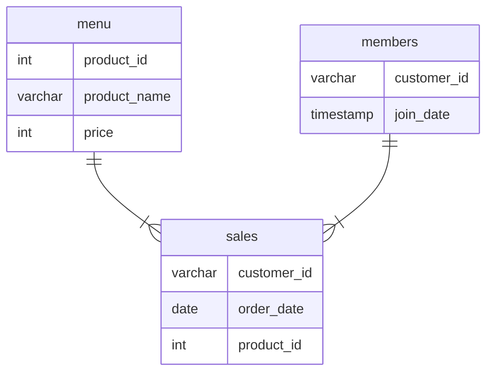

# Case Study #1: Danny's Diner

## Table of Contents
- [Problem Statement](#problem-statement)
- [Dataset](#dataset)
- [Solutions](#solutions)

## Problem Statement
>Danny wants to use the data to answer a few simple questions about his customers, especially about their visiting patterns, how much money they’ve spent and also which menu items are their favourite. 

## Dataset
This case study, we're inspecting three dataset samples: sales, menu, and members.

The entity relationship diagram is shown below.


### Sales
The `sales` table captures all `customer_id` level purchases with an corresponding `order_date` and `product_id` information for when and what menu items were ordered.

<details>
<summary>View Table</summary>

| customer_id | order_date | product_id |
|---|---|---:|
| A | 2021-01-01 | 1 |
| A | 2021-01-01 | 2 |
| A | 2021-01-07 | 2 |
| A | 2021-01-10 | 3 |
| A | 2021-01-11 | 3 |
| A | 2021-01-11 | 3 |
| B | 2021-01-01 | 2 |
| B | 2021-01-02 | 2 |
| B | 2021-01-04 | 1 |
| B | 2021-01-11 | 1 |
| B | 2021-01-16 | 3 |
| B | 2021-02-01 | 3 |
| C | 2021-01-01 | 3 |
| C | 2021-01-01 | 3 |
| C | 2021-01-07 | 3 |

</details>

### Menu
The `menu` table maps the `product_id` to the actual `product_name` and `price` of each menu item.

<details>
<summary>View Table</summary>

| product_id | product_name | price |
|---|---|---|
| 1 | sushi | 10 |
| 2 | curry | 15 |
| 3 | ramen | 12 |
</details>

### Members
The final `members` table captures the `join_date` when a `customer_id` joined the beta version of the Danny's Diner loyalty program

<details>
<summary>View Table</summary>

| customer_id | join_date |
|---|---|
| A | 2021-01-07 |
| B | 2021-01-09 |

</details>

## Solutions

### Q1) What is the total amount each customer spent at the restaurant?

**Query:**

```
SELECT
  	s.customer_id,
    CONCAT('$', SUM(price)) AS total_spent
FROM sales AS s JOIN menu as m
ON s.product_id = m.product_id
GROUP BY s.customer_id
ORDER By s.customer_id
```

**Result**

| customer_id | total_spent |
|---|---|
|A  | $76    |
|B  | $74    |
|C  | $36    |


### Q2) How many days has each customer visited the restaurant?
**Query:**
```
SELECT 
	customer_id,
    COUNT(DISTINCT(order_date)) AS total_visits
FROM sales
GROUP BY customer_id
ORDER BY customer_id

```

**Result:**

| customer_id | total_visits |
|---|---|
|A  | 4    |
|B  | 6    |
|C  | 2    |


:warning: Since timestamps are not provided, it is assumed that multiple purchases in one day count towards one order, hence one visit.


### Q3) What was the first item from the menu purchased by each customer?
**Query:**
```
SELECT DISTINCT ON (customer_id)
	customer_id,
	product_name
FROM menu
JOIN sales 
ON menu.product_id = sales.product_id
ORDER BY customer_id, order_date, menu.product_id ASC


SELECT
    order_date,
    customer_id,
    product_name
FROM menu
JOIN sales 
ON menu.product_id = sales.product_id
WHERE (customer_id, order_date) IN (
    SELECT customer_id, MIN(order_date)
    FROM sales
    GROUP BY customer_id)
ORDER BY customer_id, order_date, menu.product_id
```

**Result:**
|order_date | customer_id | product_name |
|---|---|---|
| 2021-01-01 |A | sushi |
| 2021-01-01 |A | curry|
| 2021-01-01 |B | curry |
| 2021-01-01 |C | ramen |
| 2021-01-01 |C | ramen |

:warning: This query retrieves all items ordered by each customers from the first date recorded in the sales table. Without timestamp information, it is difficult to determine which item was purchased first in the same day (if seperate visits). 

### Q4) What is the most purchased item on the menu and how many times was it purchased by all customers?
**Query:**
```
SELECT
    product_name,
    COUNT(*) AS total_orders
FROM sales
JOIN menu on sales.product_id = menu.product_id
GROUP BY product_name
LIMIT 1
```

**Result:**
| product_name | total_orders |
|---|---|
| ramen  | 8 |

### Q5) Which item was the most popular for each customer?
**Query:**
```
SELECT DISTINCT ON(customer_id)
    customer_id,
    product_name,
    COUNT(*) AS order_count
FROM sales
JOIN menu on sales.product_id = menu.product_id
GROUP BY customer_id, product_name
ORDER BY customer_id, order_count DESC
```

**Result:**
| customer_id |	product_name | order_count |
| --- | --- | --- |
| A	| ramen	| 3 |
| B	| ramen	| 2 |
| C | ramen	| 3 |


### Q6) Which item was purchased first by the customer after they became a member?
**Query:**
```

```

**Result:**


### Q8) What is the total items and amount spent for each member before they became a member?
**Query:**
```

```

**Result:**


### Q9) If each $1 spent equates to 10 points and sushi has a 2x points multiplier - how many points would each customer have?
**Query:**
```
```

**Result:**

### Q10) In the first week after a customer joins the program (including their join date) they earn 2x points on all items, not just sushi - how many points do customer A and B have at the end of January?

**Query:**
```
```

**Result:**

### Join All

### Rank 


## Conclusion and Recommendations