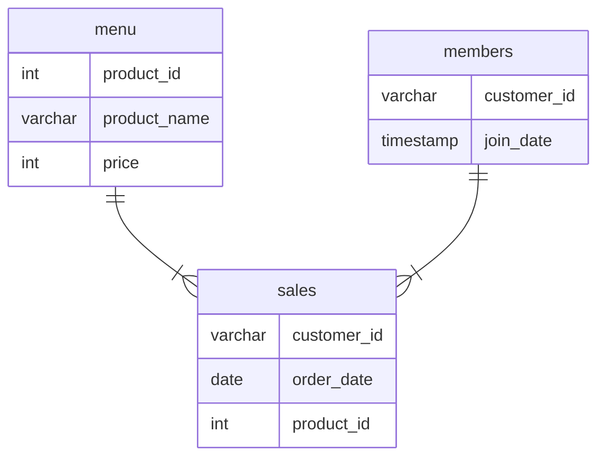

# Case Study 1: Danny's Diner

## Table of Contents
- [Problem Statement](#problem-statement)
- [Dataset](#dataset)
- [Solutions](#solutions)

## Problem Statement
Danny wants to use the data to answer a few simple questions about his customers, especially about their **visiting patterns**, **how much money they’ve spent** and also **which menu items are their favourite**. 

## Dataset
In this case study, we're inspecting three datasets: sales, menu, and members.

The following entity relationship diagram maps out the relationship between the tables.



### Sales
The `sales` table captures all `customer_id` level purchases with an corresponding `order_date` and `product_id` information for when and what menu items were ordered.

<details>
<summary>View Table</summary>

| customer_id | order_date | product_id |
|---|---|---:|
| A | 2021-01-01 | 1 |
| A | 2021-01-01 | 2 |
| A | 2021-01-07 | 2 |
| A | 2021-01-10 | 3 |
| A | 2021-01-11 | 3 |
| A | 2021-01-11 | 3 |
| B | 2021-01-01 | 2 |
| B | 2021-01-02 | 2 |
| B | 2021-01-04 | 1 |
| B | 2021-01-11 | 1 |
| B | 2021-01-16 | 3 |
| B | 2021-02-01 | 3 |
| C | 2021-01-01 | 3 |
| C | 2021-01-01 | 3 |
| C | 2021-01-07 | 3 |

</details>

### Menu
The `menu` table maps the `product_id` to the actual `product_name` and `price` of each menu item.

<details>
<summary>View Table</summary>

| product_id | product_name | price |
|---|---|---|
| 1 | sushi | 10 |
| 2 | curry | 15 |
| 3 | ramen | 12 |
</details>

### Members
The final `members` table captures the `join_date` when a `customer_id` joined the beta version of the Danny's Diner loyalty program

<details>
<summary>View Table</summary>

| customer_id | join_date |
|---|---|
| A | 2021-01-07 |
| B | 2021-01-09 |

</details>

\
:exclamation: Due to data privacy issues, only a sample of the overall customer data is provided. The SQL queries in this case study are designed to help Danny answer key business questions and uncover insights from the available data.

## Business Questions
1. What is the total amount each customer spent at the restaurant?
2. How many days has each customer visited the restaurant?
3. What was the first item from the menu purchased by each customer?
4. What is the most purchased item on the menu and how many times was it purchased by all customers?
5. Which item was the most popular for each customer?
6. Which item was purchased first by the customer after they became a member?
7. Which item was purchased just before the customer became a member?
8. What is the total items and amount spent for each member before they became a member?
9. If each $1 spent equates to 10 points and sushi has a 2x points multiplier - how many points would each customer have?
10. In the first week after a customer joins the program (including their join date) they earn 2x points on all items, not just sushi - how many points do customer A and B have at the end of January?


## Bonus Questions

## Solutions

### Q1) What is the total amount each customer spent at the restaurant?

**Query:**

```
SELECT
  s.customer_id,
  CONCAT('$', SUM(price)) AS total_spent
FROM sales AS s JOIN menu as m
ON s.product_id = m.product_id
GROUP BY s.customer_id
ORDER By s.customer_id
```

*The total amount spent per customer `total_spent` is calculated using `SUM(price)`. An inner join is used to combine the `sales` and `menu` tables so that the product prices stored in `menu` can be associated with each sale. The results are then grouped and ordered by `customer_id`.*

**Result**:

| customer_id | total_spent |
|---|---|
|A  | $76    |
|B  | $74    |
|C  | $36    |

*Customer A spent the most with $76 total amount spent, followed by customer B with $74 and then C with $36.*

### Q2) How many days has each customer visited the restaurant?

**Query:**
```
SELECT 
	customer_id,
    COUNT(DISTINCT(order_date)) AS total_visits
FROM sales
GROUP BY customer_id
ORDER BY customer_id
```

*To determine the frequency of visits per customer, `COUNT(DISTINCT(order_date))` is used. Since each row in the `sales` table represents a purchase of an individual item, customers may have multiple rows with the same `order_date` when purchasing multiple items during a single visit. Using `DISTINCT` ensures that each visit is counted only once.*

**Result:**

| customer_id | total_visits |
|---|---|
|A  | 4    |
|B  | 6    |
|C  | 2    |


:warning: *Since timestamps are not provided, it is assumed that multiple purchases in one day count towards one order, hence one visit.*


### Q3) What was the first item from the menu purchased by each customer?
**Query:**
```
WITH first_orders AS (
    SELECT
        customer_id,
        MIN(order_date) AS first_order_date
    FROM sales
    GROUP BY customer_id
)
SELECT
    sales.customer_id,
    STRING_AGG(product_name, ', ') AS first_order 
FROM sales 
JOIN first_orders
    ON sales.customer_id = first_orders.customer_id
    AND sales.order_date = first_orders.first_order_date
JOIN menu
    ON menu.product_id = sales.product_id
GROUP BY sales.customer_id
```

**

**Result:**
| customer_id | product_name |
|---|---|
|A | sushi, curry |
|B | curry        |
|C | ramen, ramen |


:warning: *This query retrieves all items ordered by each customers from the first date recorded in the sales table. Without timestamp information, it is difficult to determine which item was purchased first in the same day (if seperate visits).*

### Q4) What is the most purchased item on the menu and how many times was it purchased by all customers?
**Query:**
```
SELECT TOP 1
    product_name,
    COUNT(*) AS total_orders
FROM sales
JOIN menu on sales.product_id = menu.product_id
GROUP BY product_name
ORDER BY total_orders DESC;
```


**Result:**
| product_name | total_orders |
|---|---|
| ramen  | 8 |

*Ramen appears to be the most popular item on the menu, purchased 8 times by customers.*

### Q5) Which item was the most popular for each customer?
**Query:**
```
WITH order_counts AS (
    SELECT 
        customer_id,
        product_name,
        COUNT(*) AS order_count
    FROM sales
    JOIN menu
        ON sales.product_id = menu.product_id
    GROUP BY customer_id, product_name
),
ranked AS (
    SELECT *,
        RANK() OVER (
            PARTITION BY customer_id
            ORDER BY order_count DESC
        ) AS rnk
    FROM order_counts
)
SELECT
    customer_id,
    STRING_AGG(product_name, ', ') AS product_name,
    MAX(order_count) AS top_order
FROM ranked
WHERE rnk = 1
GROUP BY customer_id
ORDER BY customer_id;
```

**Result:**
| customer_id |	product_name | order_count |
| --- | --- | --- |
| A	| ramen	| 3 |
| B	| sushi, curry, ramen| 2 |
| C | ramen	| 3 |


### Q6) Which item was purchased first by the customer after they became a member?
**Query:**
```

```

**Result:**


### Q8) What is the total items and amount spent for each member before they became a member?
**Query:**
```

```

**Result:**


### Q9) If each $1 spent equates to 10 points and sushi has a 2x points multiplier - how many points would each customer have?
**Query:**
```
WITH points_item AS (
    SELECT *,
    CASE 
    WHEN product_name = 'sushi' THEN 20
    ELSE 10
    END AS multiplier
    FROM menu
) 
SELECT
    s.customer_id,
    SUM(p.price*p.multiplier) AS total_points
FROM sales as s
JOIN points_item as p
ON s.product_id = p.product_id
GROUP BY s.customer_id
```

**Result:**
| customer_id | total_points |
|---|---|
|A | 860 |
|B | 940 |
|C | 360 |

### Q10) In the first week after a customer joins the program (including their join date) they earn 2x points on all items, not just sushi - how many points do customer A and B have at the end of January?

**Query:**
```
```

**Result:**

### Join All The Things

**Query:**
```
WITH customer_orders AS (
    SELECT 
        sales.*,
        members.join_date,
        menu.product_name,
        menu.price
    FROM sales
    LEFT JOIN members 
        ON sales.customer_id = members.customer_id
    JOIN menu 
        ON menu.product_id = sales.product_id
),
member_status AS (
    SELECT
        *,
        CASE 
            WHEN DATEDIFF(day, join_date, order_date) >= 0 THEN 'Y'
            ELSE 'N'
        END AS member
    FROM customer_orders
)
SELECT 
    customer_id,
    order_date,
    product_name,
    price,
    member
FROM member_status
```

**Result:**
| customer_id | order_date | product_name | price | member |
|----------|------------|-------|------:|:---:|
| A        | 2021-01-01 | curry | 15    | N   |
| A        | 2021-01-01 | sushi | 10    | N   |
| A        | 2021-01-07 | curry | 15    | Y   |
| A        | 2021-01-10 | ramen | 12    | Y   |
| A        | 2021-01-11 | ramen | 12    | Y   |
| A        | 2021-01-11 | ramen | 12    | Y   |
| B        | 2021-01-01 | curry | 15    | N   |
| B        | 2021-01-02 | curry | 15    | N   |
| B        | 2021-01-04 | sushi | 10    | N   |
| B        | 2021-01-11 | sushi | 10    | Y   |
| B        | 2021-01-16 | ramen | 12    | Y   |
| B        | 2021-02-01 | ramen | 12    | Y   |
| C        | 2021-01-01 | ramen | 12    | N   |
| C        | 2021-01-01 | ramen | 12    | N   |
| C        | 2021-01-07 | ramen | 12    | N   |


### Rank 

**Query:**

```

WITH customer_orders AS (
    SELECT 
        sales.*,
        members.join_date,
        menu.product_name,
        menu.price
    FROM sales
    LEFT JOIN members 
        ON sales.customer_id = members.customer_id
    JOIN menu 
        ON menu.product_id = sales.product_id
),
member_status AS (
    SELECT
        *,
        CASE 
            WHEN DATEDIFF(day, join_date, order_date) >= 0 THEN 'Y'
            ELSE 'N'
        END AS member
    FROM customer_orders
),
ranked_members AS (
    SELECT
        *,
        CASE
            WHEN member = 'Y' THEN
                RANK() OVER (
                    PARTITION BY customer_id, member
                    ORDER BY order_date
                )
        END AS ranking
    FROM member_status
)
SELECT 
    customer_id,
    order_date,
    product_name,
    price,
    member,
    ranking
FROM ranked_members
```

**Result:**
| customer_id | order_date | product_name | price | member | ranking |
|---|---|----|------:|:---:|:---|
| A        | 2021-01-01 | curry | 15    | N   | NULL |
| A        | 2021-01-01 | sushi | 10    | N   | NULL |
| A        | 2021-01-07 | curry | 15    | Y   | 1    |
| A        | 2021-01-10 | ramen | 12    | Y   | 2    |
| A        | 2021-01-11 | ramen | 12    | Y   | 3    |
| A        | 2021-01-11 | ramen | 12    | Y   | 3    |
| B        | 2021-01-01 | curry | 15    | N   | NULL |
| B        | 2021-01-02 | curry | 15    | N   | NULL |
| B        | 2021-01-04 | sushi | 10    | N   | NULL |
| B        | 2021-01-11 | sushi | 10    | Y   | 1    |
| B        | 2021-01-16 | ramen | 12    | Y   | 2    |
| B        | 2021-02-01 | ramen | 12    | Y   | 3    |
| C        | 2021-01-01 | ramen | 12    | N   | NULL |
| C        | 2021-01-01 | ramen | 12    | N   | NULL |
| C        | 2021-01-07 | ramen | 12    | N   | NULL |

## Insights and Recommendations

:exclamation:**Ramen is the most popular item on the menu**, accounting for 8 out of 15 purchases. It is a favorite by both members (A and B) and non-members (C). *Danny should keep ramen on the menu and consider expanding the offering by introducing different ramen variations.*

:exclamation:**Curry, the most expensive product, was only purchased 4 times**, which may indicate low demand for its higher price point. *Danny may want to review its pricing, portion, or overall positioning before deciding whether to keep it on the menu.* 

:exclamation:**Membership behavior showed that customers tend to make a few purchases before joining the loyalty program**. After joining, customers continue to make purchases, indicating sustained engagement with the business. *Danny may seek to encourage first-time customers to join the loyalty program through introductory promotions or discounts.*


## Limitations
:warning:
