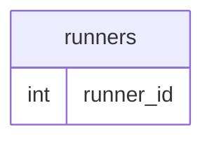

# Case Study 2: Pizza Runner

## Table of Contents
- [Problem Statement](#problem-statement)
- [Dataset](#dataset)
- [Solutions](#solutions)

## Problem Statement


## Dataset
We are provided six tables for this case study: runners, customer_orders, runner_orders, pizza_names, pizza_recipes, and pizza_toppings. Their relationships are shown in the entity relationship diagram below.


### Runners
The `runners` table shows the `registration_date` of each runner.
<details>
<summary>View Table</summary>


</details>

### Customer Orders
Customer pizza orders are captured in the `customer_orders` table with 1 row for each individual pizza that is part of the order.

<details>
<summary>View Table</summary>

</details>


### Runner Orders
After each orders are received through the system - they are assigned to a runner - however not all orders are fully completed and can be cancelled by the restaurant or the customer.

<details>
<summary>View Table</summary>

| order_id | runner_id | pickup_time          | distance | duration   | cancellation            |
|----------|-----------|----------------------|----------|------------|--------------------------|
| 1        | 1         | 2021-01-01 18:15:34  | 20km     | 32 minutes |                          |
| 2        | 1         | 2021-01-01 19:10:54  | 20km     | 27 minutes |                          |
| 3        | 1         | 2021-01-03 00:12:37  | 13.4km   | 20 mins    | NaN                      |
| 4        | 2         | 2021-01-04 13:53:03  | 23.4     | 40         | NaN                      |
| 5        | 3         | 2021-01-08 21:10:57  | 10       | 15         | NaN                      |
| 6        | 3         | null                 | null     | null       | Restaurant Cancellation  |
| 7        | 2         | 2020-01-08 21:30:45  | 25km     | 25mins     | null                     |
| 8        | 2         | 2020-01-10 00:15:02  | 23.4 km  | 15 minute  | null                     |
| 9        | 2         | null                 | null     | null       | Customer Cancellation   |
| 10       | 1         | 2020-01-11 18:50:20  | 10km     | 10minutes  | null 

</details>


### Pizza Names
At the moment - Pizza Runner only has 2 pizzas available the Meat Lovers or Vegetarian!

<details>
<summary>View Table</summary>


</details>

### Pizza Recipes
Each `pizza_id` has a standard set of `toppings` which are used as part of the pizza recipe.

<details>
<summary>View Table</summary>


</details>


### Pizza Toppings

<details>
<summary>View Table</summary>

| runner_id | registration_date |
| --- | --- |
| 1 | 2021-01-01 |
| 2 | 2021-01-03 |
| 3 | 2021-01-08 |
| 4 | 2021-01-15 |

</details>

## Data Cleaning and Preprocessing
Some known data quality issues must be addressed by cleaning before analysis. Cleaned tables are stored in temporary tables. 

### `customer_orders`
:warning: **Issues**: A mix of 'null' strings and blank entries are found in `exclusions` as well as `NaN` value in `extras`.

:bulb: **Solution**: Convert 'null' strings to `NULL` using NULLIF and nest inside COALESCE to convert `NULL` to blanks which indicate that the customer had not requested any exclusion or extra in their order.

### `runner_orders`
:warning: **Issues**:

:bulb: **Solution**:

## Solutions

**Q1: What is the total amount each customer spent at the restaurant?**
```

```

**A1:**


**Q2:**
```

```

**Q3:**
```

```

**Q4:**
```

```

**Q5:**
```

```

**Q6:**
```

```

**Q7:**
```

```
