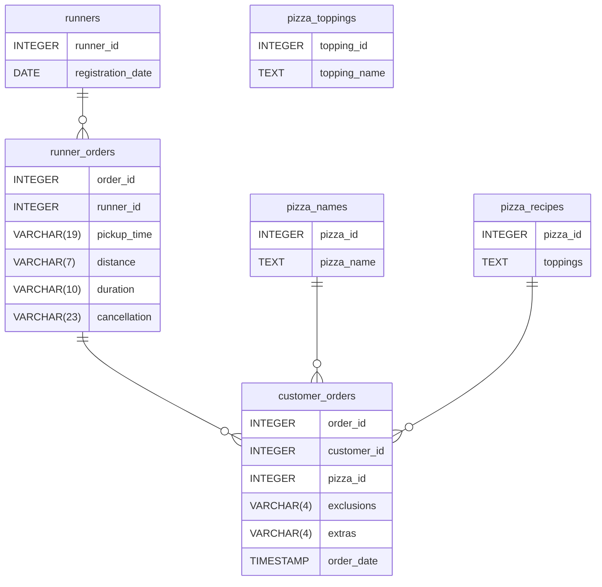

# Case Study 2: Pizza Runner

## Table of Contents
- [Problem Statement](#problem-statement)
- [Dataset](#dataset)
- [Data Cleaning](#data-cleaning-and-preprocessing)
- [Case Study](#case-study)

## Problem Statement
Danny started recruiting "runners" to deliver pizza from Pizza Runner Headquarters and commissioned an app where customers can place their orders. To better direct his runners and optimize Pizza Runner's operations he collected data.

## Dataset
We are provided six tables for this case study: runners, customer_orders, runner_orders, pizza_names, pizza_recipes, and pizza_toppings. Their relationships are shown in the entity relationship diagram below.


### Runners
The `runners` table shows the `registration_date` of each runner.
<details>
<summary>View Table</summary>

| runner_id | registration_date |
|---|---|
| 1 | 2021-01-01 |
| 2 | 2021-01-03 |
| 3 | 2021-01-08 |
| 4 | 2021-01-15 |

</details>

### Customer Orders
Customer pizza orders are captured in the `customer_orders` table with 1 row for each individual pizza that is part of the order.

<details>
<summary>View Table</summary>

| order_id | customer_id | pizza_id | exclusions | extras | order_time |
|:---:|:---:|:---:|---|---|---|
| 1 | 101 | 1 |  |  | 2021-01-01 18:05:02 |
| 2 | 101 | 1 |  |  | 2021-01-01 19:00:52 |
| 3 | 102 | 1 |  |  | 2021-01-02 23:51:23 |
| 3 | 102 | 2 |  | NaN | 2021-01-02 23:51:23 |
| 4 | 103 | 1 | 4 |  | 2021-01-04 13:23:46 |
| 4 | 103 | 1 | 4 |  | 2021-01-04 13:23:46 |
| 4 | 103 | 2 | 4 |  | 2021-01-04 13:23:46 |
| 5 | 104 | 1 | null | 1 | 2021-01-08 21:00:29 |
| 6 | 101 | 2 | null | null | 2021-01-08 21:03:13 |
| 7 | 105 | 2 | null | 1 | 2021-01-08 21:20:29 |
| 8 | 102 | 1 | null | null | 2021-01-09 23:54:33 |
| 9 | 103 | 1 | 4 | 1, 5 | 2021-01-10 11:22:59 |
| 10 | 104 | 1 | null | null | 2021-01-11 18:34:49 |
| 10 | 104 | 1 | 2, 6 | 1, 4 | 2021-01-11 18:34:49 |

</details>


### Runner Orders
After each orders are received through the system - they are assigned to a runner - however not all orders are fully completed and can be cancelled by the restaurant or the customer.

<details>
<summary>View Table</summary>

| order_id | runner_id | pickup_time          | distance | duration   | cancellation            |
|----------|-----------|----------------------|----------|------------|--------------------------|
| 1        | 1         | 2021-01-01 18:15:34  | 20km     | 32 minutes |                          |
| 2        | 1         | 2021-01-01 19:10:54  | 20km     | 27 minutes |                          |
| 3        | 1         | 2021-01-03 00:12:37  | 13.4km   | 20 mins    | NaN                      |
| 4        | 2         | 2021-01-04 13:53:03  | 23.4     | 40         | NaN                      |
| 5        | 3         | 2021-01-08 21:10:57  | 10       | 15         | NaN                      |
| 6        | 3         | null                 | null     | null       | Restaurant Cancellation  |
| 7        | 2         | 2020-01-08 21:30:45  | 25km     | 25mins     | null                     |
| 8        | 2         | 2020-01-10 00:15:02  | 23.4 km  | 15 minute  | null                     |
| 9        | 2         | null                 | null     | null       | Customer Cancellation   |
| 10       | 1         | 2020-01-11 18:50:20  | 10km     | 10minutes  | null 

</details>


### Pizza Names
At the moment - Pizza Runner only has 2 pizzas available the Meat Lovers or Vegetarian!

<details>
<summary>View Table</summary>

| pizza_id | pizza_name |
|:---:|---|
| 1 | Meat Lovers |
| 2 | Vegetarian |

</details>

### Pizza Recipes
Each `pizza_id` has a standard set of `toppings` which are used as part of the pizza recipe.

<details>
<summary>View Table</summary>

| pizza_id | toppings |
|:---:|---|
| 1 | 1, 2, 3, 4, 5, 6, 8, 10 |
| 2 | 4, 6, 7, 9, 11, 12 |

</details>


### Pizza Toppings
This table contains all of the `topping_name` values with their corresponding `topping_id` value

<details>
<summary>View Table</summary>

| topping_id | topping_name |
|:---: | --- |
| 1 | Bacon |
| 2 | BBQ Sauce |
| 3 | Beef |
| 4 | Cheese |
| 5 | Chicken |
| 6 | Mushrooms |
| 7 | Onions |
| 8 | Pepperoni |
| 9 | Peppers |
| 10 | Salami |
| 11 | Tomatoes |
| 12 | Tomato Sauce |

</details>

## Data Cleaning and Preprocessing
After inspecting the tables, several data quality issues were identified that need to be addressed before conducting the analysis. The data was cleaned and preprocessed then stored in temporary tables for subsequent analysis.

### `customer_orders`
**Issues**: A mix of 'null' strings and blank entries were found in `exclusions` as well as `NaN` value in `extras`.

**Solution**: The `'null'` strings were converted to `NULL` using `NULLIF()` and then nested inside `COALESCE()` to replace `NULL` values with a blank space. This indicates that the customer did not request any exclusions or extras for their order.

```
SELECT
order_id,
customer_id,
pizza_id,
COALESCE(NULLIF(exclusions, 'NULL'), ' ') AS exclusions,
COALESCE(NULLIF(extras, 'NULL'), ' ') AS extras,
order_time
INTO #customer_orders_cleaned
FROM customer_orders
```

### `runner_orders`
**Issues**: Null values were inconsistently stored in multiple columns. In `pickup_time`, null values were stored as strings. In  `distance` and `duration` null values were stored as strings alongside measurement units such as 'km', 'mins', 'minutes', and 'minute'. In `cancellation`, missing values were represented by blanks, `NaN` values, and string null values. 

**Solution**:
- `pickup_time`: `'null'` strings were converted to `NULL` using `NULLIF()` nested inside `COALESCE()`.
- `distance`: The 'km' unit was removed using `REPLACE()`. 'null' strings are converted to `NULL` using `NULLIF()` nested inside `COALESCE()`. Finally, `CAST()` was used to convert the values to `DECIMAL(10,2)`. This was performed last after removing strings to prevent conversion errors.
- `duration`: The units 'mins', 'minutes', 'minute' were removed through `REPLACE()` nested three times. String nulls were converted to `NULL` using `NULLIF()` nested inside `COALESCE()`.  Finally, `CAST()` was used to convert the values to `DECIMAL(10,2)`. This was performed last after removing strings to prevent conversion errors.
- `cancellation`: The null strings were adressed first using `NULLIF()` converting them to `NULL`. This was nested inside another `NULLIF()` to convert the blank entries `''` to `NULL`.

```
SELECT 
order_id,
runner_id,
COALESCE(NULLIF(pickup_time, 'null'), NULL) AS pickup_time_,
CAST(COALESCE(NULLIF(REPLACE(distance, 'km', ''),'null'), NULL) AS DECIMAL(10,2)) AS distance,
CAST(COALESCE(NULLIF(REPLACE(REPLACE(REPLACE(duration, 'mins', ''),'minutes', ''),'minute', ''),'NULL'), NULL) AS DECIMAL(10,2)) AS duration,
COALESCE(NULLIF(NULLIF(cancellation, 'null'),''), NULL) AS cancellation
INTO #runner_orders_cleaned
FROM runner_orders
```

## Case Study
This case study is organised into several key areas of focus, including pizza metrics, runner and customer experience, ingredient optimisation, pricing and ratings, and other data manipulation challenges.
### A. Pizza Metrics

#### 1. How many pizzas were ordered?

**Query:**
```
SELECT 
    COUNT(*) AS total_pizzas_ordered 
FROM #customer_orders_cleaned
```

**Result**:
| total_pizzas_ordered | 
| --- |
| 14 |

*There were a total of 14 pizzas ordered.*

#### 2. How many unique customer orders were made?
**Query:**
```
SELECT 
    COUNT(DISTINCT order_id) AS unique_customer_orders 
FROM #customer_orders_cleaned
```

**Result:**
| unique_customer_orders | 
| --- |
| 10 |

*There were 10 unique customer orders.*

#### 3. How many successful orders were delivered by each runner?

**Query:**
```
SELECT 
    COUNT(*) AS successful_deliveries 
FROM #runner_orders_cleaned 
WHERE cancellation IS NULL
```
**Result:**
| successful_deliveries |
| --- |
| 8 |

*There were 8 successful deliveries out of 10 total orders.*


#### 4. How many of each type of pizza was delivered?

**Query:**
```
SELECT 
	CAST(p.pizza_name AS VARCHAR(20)) AS pizza_name,
	COUNT(*) AS pizzas_delivered
FROM #runner_orders_cleaned as ro 
JOIN #customer_orders_cleaned as co 
ON ro.order_id = co.order_id
JOIN pizza_names as p 
ON co.pizza_id = p.pizza_id
WHERE cancellation IS NULL
GROUP BY CAST(p.pizza_name AS VARCHAR(20))
```

**Result:**
| pizza_name | pizzas_delivered |
| --- | --- |
| Meat Lovers | 9 |
| Vegetarian | 3 |

*There were 9 Meat Lovers pizzas and 3 Vegetarian pizzas delivered.*

#### 5. How many Vegetarian and Meatlovers were ordered by each customer?
**Query:**
```
SELECT 
	CAST(p.pizza_name AS VARCHAR(20)) AS pizza_name,
	COUNT(*) AS pizzas_ordered
FROM #customer_orders_cleaned as co 
JOIN pizza_names as p 
ON co.pizza_id = p.pizza_id
GROUP BY CAST(p.pizza_name AS VARCHAR(20))
```
**Result:**
| pizza_name | pizzas_delivered |
| --- | --- |
| Meat Lovers | 10 |
| Vegetarian | 4 |

*Customers ordered Meat Lovers 10 times and Vegetarian 4 times.*

#### 6. What was the maximum number of pizzas delivered in a single order?
**Query:**
```
SELECT TOP 1
	co.order_id,
	COUNT(*) AS pizzas_per_order
FROM #customer_orders_cleaned AS co
JOIN #runner_orders_cleaned AS ro
ON co.order_id = ro.order_id
WHERE cancellation IS NULL
GROUP BY co.order_id
ORDER BY pizzas_per_order DESC
```
**Result:**
| order_id | pizzas_per_order |
| :---: | --- |
| 4 | 3 |

*The maximum number of pizzas delivered in a single order was 3.*

#### 7. For each customer, how many delivered pizzas had at least 1 change and how many had no changes?

**Query:**
```
SELECT
	customer_id,
	COUNT(CASE 
        WHEN exclusions != '' OR extras != '' 
            THEN 1 END) AS with_changes,
	COUNT(CASE 
        WHEN exclusions = '' AND extras = '' 
        THEN 1 END) AS no_changes
FROM #customer_orders_cleaned AS co
JOIN #runner_orders_cleaned AS ro
ON co.order_id = ro.order_id
WHERE cancellation IS NULL
GROUP BY customer_id
```

**Result:**
| customer_id | with_changes | no_changes |
| :---: | --- | --- |
| 101 | 0 | 2 |
| 102 | 0 | 3 |
| 103 | 3 | 0 |
| 104 | 2 | 1 |
| 105 | 1 | 0 |

#### 8. How many pizzas were delivered that had both exclusions and extras?
**Query:**
```
SELECT
	COUNT(*) AS count
FROM #customer_orders_cleaned AS co
JOIN #runner_orders_cleaned AS ro
ON co.order_id = ro.order_id
WHERE 
	cancellation IS NULL AND
	exclusions != '' AND
	extras != ''
```

**Result:**
| count |
| --- |
| 1 |

#### 9. What was the total volume of pizzas ordered for each hour of the day?
**Query:**
```
SELECT 
	DATEPART(hour, order_time) AS hour_ordered,
	COUNT(*) AS pizzas_ordered
FROM #customer_orders_cleaned
GROUP BY DATEPART(hour, order_time) 
```

**Result:**
| hour_ordered | pizzas_ordered |
| --- | --- |
| 11 | 1 |
| 13 | 3 |
| 18 | 3 |
| 19 | 1 |
| 21 | 3 |
| 23 | 3 |

#### 10. What was the volume of orders for each day of the week?
**Query:**
```
SELECT 
	DATENAME(weekday, order_time) AS day_of_week,
	COUNT(*) AS pizzas_ordered
FROM #customer_orders_cleaned
GROUP BY DATENAME(weekday, order_time), DATEPART(weekday, order_time)
ORDER BY DATEPART(weekday, order_time) 
```

**Result:**
| day_of_week | pizzas_ordered |
| --- | --- |
| Wednesday | 5 |
| Thursday | 3 |
| Friday | 1 |
| Saturday | 5 |

> #### :bulb: Important Findings
> - 

### B. Runner and Customer Experience

#### 1. How many runners signed up for each 1 week period? (i.e. week starts 2021-01-01)
**Query:**
```
SELECT
    DATEDIFF(day, '2021-01-01', registration_date) / 7 + 1 AS week_number,
    COUNT(*) AS runners_signedup
FROM runners
WHERE registration_date >= '2021-01-01'
GROUP BY DATEDIFF(day, '2021-01-01', registration_date) / 7 + 1
```

**Result:**
| week_number | runners_signedup |
| --- | --- |
| 1 | 2 |
| 2 | 1 |
| 3 | 1 |

#### 2. What was the average time in minutes it took for each runner to arrive at the Pizza Runner HQ to pickup the order?
**Query:**
```
WITH customer_orders_cte AS (
    SELECT
        order_id,
        MIN(order_time) AS order_time
    FROM #customer_orders_cleaned
    GROUP BY order_id
)
SELECT
	runner_id,
    AVG(DATEDIFF(MINUTE, co.order_time, ro.pickup_time)) AS avg_pickup_time
FROM #runner_orders_cleaned AS ro
JOIN customer_orders_cte AS co
ON ro.order_id = co.order_id
WHERE cancellation IS NULL
GROUP BY runner_id
```

**Result:**
| runner_id | avg_pickup_time |
| :---: | --- |
| 1 | 14 |
| 2 | 20 |
| 3 | 10 |

#### 3. Is there any relationship between the number of pizzas and how long the order takes to prepare?
**Query:**
```
WITH prep_time_cte AS (
SELECT 
    co.order_id, 
    COUNT(co.order_id) AS pizza_order, 
    order_time, 
    pickup_time, 
    DATEDIFF(MINUTE, order_time, pickup_time) AS prep_time
  FROM #customer_orders_cleaned AS co
  JOIN #runner_orders_cleaned AS ro
    ON co.order_id = ro.order_id
  WHERE cancellation IS NULL
  GROUP BY co.order_id, order_time, pickup_time
  )
SELECT 
  pizza_order, 
  AVG(prep_time) AS avg_prep_time_minutes
FROM prep_time_cte
GROUP BY pizza_order
```

**Result:**
| pizza_order | avg_prep_time_minutes |
| --- | --- |
| 1 | 12 |
| 2 | 18 |
| 3 | 30 |

#### 4. What was the average distance travelled for each customer?
**Query:**
```
WITH order_distances AS (
    SELECT DISTINCT
        co.customer_id,
        co.order_id,
        distance
    FROM #customer_orders_cleaned AS co
    JOIN #runner_orders_cleaned AS ro
        ON co.order_id = ro.order_id
    WHERE cancellation IS NULL
)
SELECT
    customer_id,
    ROUND(AVG(distance), 2) AS avg_distance
FROM order_distances
GROUP BY customer_id
ORDER BY customer_id
```

**Result:**
| customer_id | avg_distance |
| :---: | --- |
| 101 | 20.00 |
| 102 | 18.40 |
| 103 | 23.40 |
| 104 | 10.00 |
| 105 | 25.00 |


#### 5. What was the difference between the longest and shortest delivery times for all orders?
**Query:**
```
WITH delivery_times_cte AS (
    SELECT
        order_id,
        duration
    FROM #runner_orders_cleaned
    WHERE cancellation IS NULL
)
SELECT
    MIN(duration) AS shortest_delivery,
    MAX(duration) AS longest_delivery,
	MAX(duration) - MIN(duration) AS difference
FROM delivery_times_cte
```

**Result:**
| shortest_delivery | longest_delivery | difference |
| --- | --- | --- |
| 10.00 | 40.00 | 30.00 |


#### 6. What was the average speed for each runner for each delivery and do you notice any trend for these values?
**Query:**
```
WITH runner_speed_cte AS (
    SELECT DISTINCT
        runner_id,
        co.order_id,
        duration
    FROM #runner_orders_cleaned AS ro
    JOIN #customer_orders_cleaned AS co
        ON co.order_id = ro.order_id
    WHERE cancellation IS NULL
)
SELECT
    runner_id,
    ROUND(AVG(duration), 2) AS avg_duration
FROM runner_speed_cte
GROUP BY runner_id
ORDER BY runner_id
```

**Result:**
| runner_id | avg_duration |
| :---: | --- |
| 1 | 22.25 |
| 2 | 26.67 |
| 3 | 15.00 |

#### 7. What is the successful delivery percentage for each runner?
**Query:**
```
WITH success_count_cte AS (
SELECT
    ro.runner_id,
    CAST(SUM(CASE 
            WHEN cancellation IS NULL 
            THEN 1 ELSE 0 END) 
            AS FLOAT) AS success,
    COUNT(*) AS assigned_deliveries
FROM #runner_orders_cleaned AS ro
JOIN #customer_orders_cleaned AS co
ON ro.order_id = co.order_id
GROUP BY ro.runner_id
)

SELECT
    *,
    ROUND((success /assigned_deliveries) * 100 , 2) AS success_perc
FROM success_count_cte 
```

**Result:**
| runner_id | success | assigned_deliveries | success_perc |
| :---: | --- | --- | --- |
| 1 | 6 | 6 | 100 |
| 2 | 5 | 6 | 83.33 |
| 3 | 1 | 2 | 50 |

> #### :bulb: Important Findings
> - 

### C. Ingredient Optimisation

#### What are the standard ingredients for each pizza?
**Query:**
```
SELECT
    CAST(pizza_name AS VARCHAR(MAX)) AS pizza_name,
    STRING_AGG(CAST(topping_name AS VARCHAR(MAX)), ', ') AS ingredients
FROM pizza_recipes r
CROSS APPLY STRING_SPLIT(CAST(r.toppings AS VARCHAR(MAX)), ',') s
JOIN pizza_names pn ON pn.pizza_id = r.pizza_id
LEFT JOIN pizza_toppings t 
    ON TRIM(s.value) = t.topping_id
GROUP BY pn.pizza_id, CAST(pizza_name AS VARCHAR(MAX))
```

**Result:**
| pizza_name | ingredients |
| --- | --- |
| Meatlovers | Bacon, BBQ Sauce, Beef, Cheese, Chicken, Mushrooms, Pepperoni, Salami |
| Vegetarian | Cheese, Mushrooms, Onions, Peppers, Tomatoes, Tomato Sauce |


#### What was the most commonly added extra?

**Query:**
```
WITH extras_cte AS(
    SELECT 
        order_id,
        topping_name
    FROM #customer_orders_cleaned c
    CROSS APPLY STRING_SPLIT(extras, ',') AS s
    JOIN pizza_toppings AS t 
        ON TRIM(s.value) = t.topping_id
)
SELECT TOP 1
    CAST(topping_name AS VARCHAR(MAX)) AS topping_name,
    COUNT(*) AS count
FROM extras_cte
GROUP BY CAST(topping_name AS VARCHAR(MAX))
ORDER BY count DESC
```

**Result:**


####

**Query:**
```
WITH extras_cte AS(
    SELECT 
        order_id,
        pizza_id,
        STRING_AGG(CAST(t.topping_name AS VARCHAR(MAX)), ', ') AS extras
    FROM #customer_orders_cleaned c
    CROSS APPLY STRING_SPLIT(extras, ',') AS s
    JOIN pizza_toppings AS t 
        ON TRIM(s.value) = t.topping_id
    GROUP BY order_id, pizza_id
), exclusions_cte AS(
    SELECT 
        order_id,
        pizza_id,
        STRING_AGG(CAST(t.topping_name AS VARCHAR(MAX)), ', ') AS exclusions
    FROM #customer_orders_cleaned c
    CROSS APPLY STRING_SPLIT(exclusions, ',') AS s
    JOIN pizza_toppings AS t 
        ON TRIM(s.value) = t.topping_id
    GROUP BY order_id, pizza_id
)
SELECT
    co.order_id,
    co.customer_id,
    co.order_time,
    CONCAT(
        CAST(pn.pizza_name AS VARCHAR(MAX)),
        CASE WHEN excl.exclusions IS NOT NULL
            THEN ' - Exclude ' + excl.exclusions ELSE '' END,
        CASE WHEN extra.extras IS NOT NULL
            THEN ' - Extra ' + extra.extras ELSE '' END
    ) AS order_details
FROM #customer_orders_cleaned AS co
LEFT JOIN extras_cte AS extra
    ON co.order_id = extra.order_id
LEFT JOIN exclusions_cte AS excl
    ON excl.order_id = co.order_id
JOIN pizza_names as pn
    ON co.pizza_id = pn.pizza_id

```
