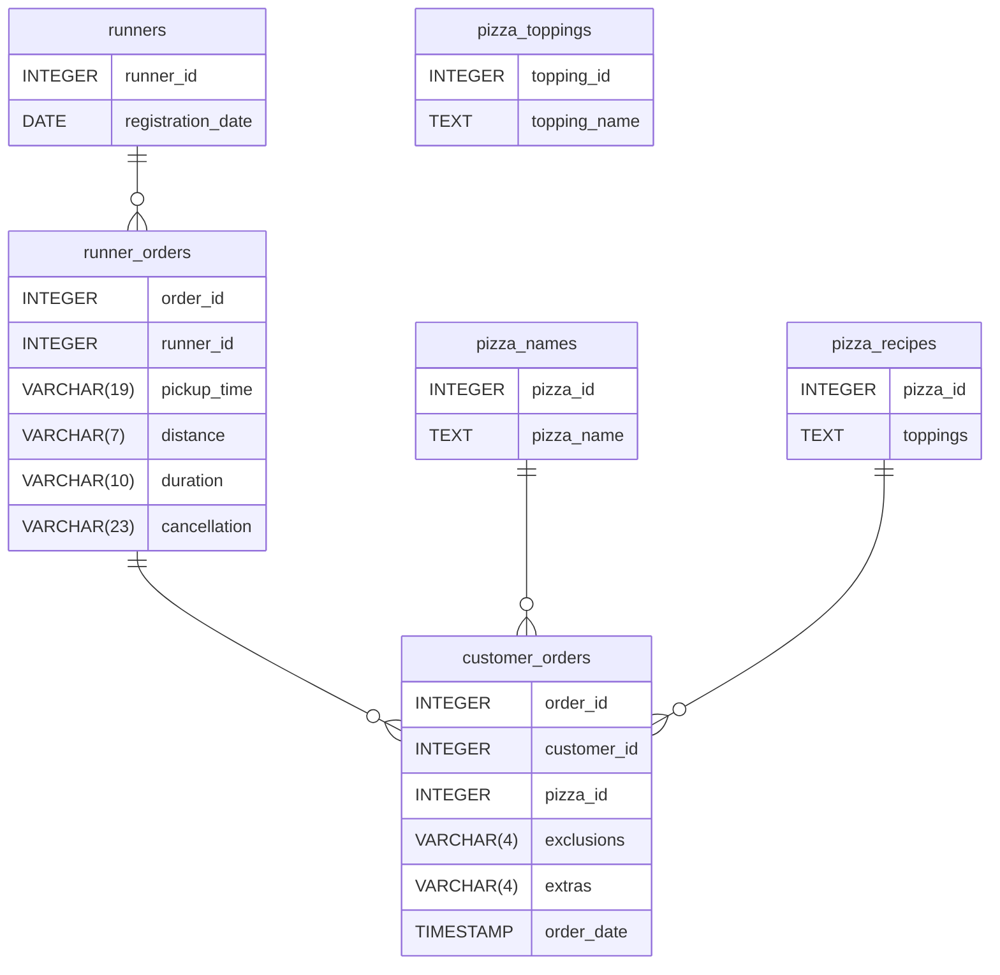

# Case Study 2: Pizza Runner

## Table of Contents
- [Problem Statement](#problem-statement)
- [Dataset](#dataset)
- [Data Cleaning](#data-cleaning-and-preprocessing)
- [Case Study](#case-study)
  - [Pizza Metrics](#a-pizza-metrics)
  - [Runner and Customer Experience](#b-runner-and-customer-experience)
  - [Ingredient Optimization](#c-ingredient-optimisation)
  - [Pricing and Ratings](#d-pricing-and-ratings)

## Problem Statement
Danny started recruiting "runners" to deliver pizzas from Pizza Runner Headquarters and commissioned an app where customers can place their orders. To gain insights into business performance and identify opportunities for improvement, he collected data on menu information, order details and runner performance for analysis.

## Dataset
We are provided six tables for this case study: runners, customer_orders, runner_orders, pizza_names, pizza_recipes, and pizza_toppings. Their relationships are shown in the entity relationship diagram below.


### Runners
The `runners` table shows the `registration_date` of each runner.
<details>
<summary>View Table</summary>

| runner_id | registration_date |
|---|---|
| 1 | 2021-01-01 |
| 2 | 2021-01-03 |
| 3 | 2021-01-08 |
| 4 | 2021-01-15 |

</details>

### Customer Orders
Customer pizza orders are captured in the `customer_orders` table with 1 row for each individual pizza that is part of the order.

<details>
<summary>View Table</summary>

| order_id | customer_id | pizza_id | exclusions | extras | order_time |
|:---:|:---:|:---:|---|---|---|
| 1 | 101 | 1 |  |  | 2021-01-01 18:05:02 |
| 2 | 101 | 1 |  |  | 2021-01-01 19:00:52 |
| 3 | 102 | 1 |  |  | 2021-01-02 23:51:23 |
| 3 | 102 | 2 |  | NaN | 2021-01-02 23:51:23 |
| 4 | 103 | 1 | 4 |  | 2021-01-04 13:23:46 |
| 4 | 103 | 1 | 4 |  | 2021-01-04 13:23:46 |
| 4 | 103 | 2 | 4 |  | 2021-01-04 13:23:46 |
| 5 | 104 | 1 | null | 1 | 2021-01-08 21:00:29 |
| 6 | 101 | 2 | null | null | 2021-01-08 21:03:13 |
| 7 | 105 | 2 | null | 1 | 2021-01-08 21:20:29 |
| 8 | 102 | 1 | null | null | 2021-01-09 23:54:33 |
| 9 | 103 | 1 | 4 | 1, 5 | 2021-01-10 11:22:59 |
| 10 | 104 | 1 | null | null | 2021-01-11 18:34:49 |
| 10 | 104 | 1 | 2, 6 | 1, 4 | 2021-01-11 18:34:49 |

</details>


### Runner Orders
After each orders are received through the system - they are assigned to a runner - however not all orders are fully completed and can be cancelled by the restaurant or the customer.

<details>
<summary>View Table</summary>

| order_id | runner_id | pickup_time          | distance | duration   | cancellation            |
|----------|-----------|----------------------|----------|------------|--------------------------|
| 1        | 1         | 2021-01-01 18:15:34  | 20km     | 32 minutes |                          |
| 2        | 1         | 2021-01-01 19:10:54  | 20km     | 27 minutes |                          |
| 3        | 1         | 2021-01-03 00:12:37  | 13.4km   | 20 mins    | NaN                      |
| 4        | 2         | 2021-01-04 13:53:03  | 23.4     | 40         | NaN                      |
| 5        | 3         | 2021-01-08 21:10:57  | 10       | 15         | NaN                      |
| 6        | 3         | null                 | null     | null       | Restaurant Cancellation  |
| 7        | 2         | 2020-01-08 21:30:45  | 25km     | 25mins     | null                     |
| 8        | 2         | 2020-01-10 00:15:02  | 23.4 km  | 15 minute  | null                     |
| 9        | 2         | null                 | null     | null       | Customer Cancellation   |
| 10       | 1         | 2020-01-11 18:50:20  | 10km     | 10minutes  | null 

</details>


### Pizza Names
At the moment - Pizza Runner only has 2 pizzas available the Meat Lovers or Vegetarian!

<details>
<summary>View Table</summary>

| pizza_id | pizza_name |
|:---:|---|
| 1 | Meat Lovers |
| 2 | Vegetarian |

</details>

### Pizza Recipes
Each `pizza_id` has a standard set of `toppings` which are used as part of the pizza recipe.

<details>
<summary>View Table</summary>

| pizza_id | toppings |
|:---:|---|
| 1 | 1, 2, 3, 4, 5, 6, 8, 10 |
| 2 | 4, 6, 7, 9, 11, 12 |

</details>


### Pizza Toppings
This table contains all of the `topping_name` values with their corresponding `topping_id` value

<details>
<summary>View Table</summary>

| topping_id | topping_name |
|:---: | --- |
| 1 | Bacon |
| 2 | BBQ Sauce |
| 3 | Beef |
| 4 | Cheese |
| 5 | Chicken |
| 6 | Mushrooms |
| 7 | Onions |
| 8 | Pepperoni |
| 9 | Peppers |
| 10 | Salami |
| 11 | Tomatoes |
| 12 | Tomato Sauce |

</details>

## Data Cleaning and Preprocessing
After inspecting the tables, several data quality issues were identified that need to be addressed before conducting the analysis. The data was cleaned and preprocessed then stored in temporary tables for subsequent analysis.

### `customer_orders`
**Issues**: A mix of 'null' strings and blank entries were found in `exclusions` as well as `NaN` value in `extras`.

**Solution**: The `'null'` strings were converted to `NULL` using `NULLIF()` and then nested inside `COALESCE()` to replace `NULL` values with a blank space. This indicates that the customer did not request any exclusions or extras for their order.

```
SELECT
order_id,
customer_id,
pizza_id,
COALESCE(NULLIF(exclusions, 'NULL'), ' ') AS exclusions,
COALESCE(NULLIF(extras, 'NULL'), ' ') AS extras,
order_time
INTO #customer_orders_cleaned
FROM customer_orders
```

### `runner_orders`
**Issues**: Null values were inconsistently stored in multiple columns. In `pickup_time`, null values were stored as strings. In  `distance` and `duration` null values were stored as strings alongside measurement units such as 'km', 'mins', 'minutes', and 'minute'. In `cancellation`, missing values were represented by blanks, `NaN` values, and string null values. 

**Solution**:
- `pickup_time`: `'null'` strings were converted to `NULL` using `NULLIF()` nested inside `COALESCE()`.
- `distance`: The 'km' unit was removed using `REPLACE()`. 'null' strings are converted to `NULL` using `NULLIF()` nested inside `COALESCE()`. Finally, `CAST()` was used to convert the values to `DECIMAL(10,2)`. This was performed last after removing strings to prevent conversion errors.
- `duration`: The units 'mins', 'minutes', 'minute' were removed through `REPLACE()` nested three times. String nulls were converted to `NULL` using `NULLIF()` nested inside `COALESCE()`.  Finally, `CAST()` was used to convert the values to `DECIMAL(10,2)`. This was performed last after removing strings to prevent conversion errors.
- `cancellation`: The null strings were adressed first using `NULLIF()` converting them to `NULL`. This was nested inside another `NULLIF()` to convert the blank entries `''` to `NULL`.

```
SELECT 
order_id,
runner_id,
COALESCE(NULLIF(pickup_time, 'null'), NULL) AS pickup_time_,
CAST(COALESCE(NULLIF(REPLACE(distance, 'km', ''),'null'), NULL) AS DECIMAL(10,2)) AS distance,
CAST(COALESCE(NULLIF(REPLACE(REPLACE(REPLACE(duration, 'mins', ''),'minutes', ''),'minute', ''),'NULL'), NULL) AS DECIMAL(10,2)) AS duration,
COALESCE(NULLIF(NULLIF(cancellation, 'null'),''), NULL) AS cancellation
INTO #runner_orders_cleaned
FROM runner_orders
```

## Case Study
This case study is divided into several key areas of focus including pizza metrics, runner and customer experience, ingredient optimisation, pricing and ratings, and other data manipulation challenges.

### A. Pizza Metrics

#### 1. How many pizzas were ordered?

**Query:**
```
SELECT 
    COUNT(*) AS total_pizzas_ordered 
FROM #customer_orders_cleaned
```

**Result**:
| total_pizzas_ordered | 
| --- |
| 14 |


#### 2. How many unique customer orders were made?
**Query:**
```
SELECT 
    COUNT(DISTINCT order_id) AS unique_customer_orders 
FROM #customer_orders_cleaned
```

**Result:**
| unique_customer_orders | 
| --- |
| 10 |


#### 3. How many successful orders were delivered by each runner?

**Query:**
```
SELECT 
    COUNT(*) AS successful_deliveries 
FROM #runner_orders_cleaned 
WHERE cancellation IS NULL
```
**Result:**
| successful_deliveries |
| --- |
| 8 |


#### 4. How many of each type of pizza was delivered?

**Query:**
```
SELECT 
	CAST(p.pizza_name AS VARCHAR(20)) AS pizza_name,
	COUNT(*) AS pizzas_delivered
FROM #runner_orders_cleaned as ro 
JOIN #customer_orders_cleaned as co 
ON ro.order_id = co.order_id
JOIN pizza_names as p 
ON co.pizza_id = p.pizza_id
WHERE cancellation IS NULL
GROUP BY CAST(p.pizza_name AS VARCHAR(20))
```

**Result:**
| pizza_name | pizzas_delivered |
| --- | --- |
| Meat Lovers | 9 |
| Vegetarian | 3 |


#### 5. How many Vegetarian and Meatlovers were ordered by each customer?
**Query:**
```
SELECT 
    customer_id,
    COUNT(CASE WHEN CAST(p.pizza_name AS VARCHAR(20)) = 'Meatlovers' THEN 1 END) AS Meatlovers,
    COUNT(CASE WHEN CAST(p.pizza_name AS VARCHAR(20)) = 'Vegetarian' THEN 1 END) AS Vegetarian
FROM #customer_orders_cleaned AS co
JOIN pizza_names as p 
ON co.pizza_id = p.pizza_id
GROUP BY customer_id
```
**Result:**
| customer_id | Meatlovers | Vegetarian |
| --- | --- | --- |
| 101 | 2 | 1 |
| 102 | 2 | 1 |
| 103 | 3 | 1 |
| 104 | 3 | 0 |
| 105 | 0 | 1 |


#### 6. What was the maximum number of pizzas delivered in a single order?
**Query:**
```
SELECT TOP 1
	co.order_id,
	COUNT(*) AS pizzas_per_order
FROM #customer_orders_cleaned AS co
JOIN #runner_orders_cleaned AS ro
ON co.order_id = ro.order_id
WHERE cancellation IS NULL
GROUP BY co.order_id
ORDER BY pizzas_per_order DESC
```
**Result:**
| order_id | pizzas_per_order |
| :---: | --- |
| 4 | 3 |

#### 7. For each customer, how many delivered pizzas had at least 1 change and how many had no changes?

**Query:**
```
SELECT
	customer_id,
	COUNT(CASE 
        WHEN exclusions != '' OR extras != '' 
            THEN 1 END) AS with_changes,
	COUNT(CASE 
        WHEN exclusions = '' AND extras = '' 
        THEN 1 END) AS no_changes
FROM #customer_orders_cleaned AS co
JOIN #runner_orders_cleaned AS ro
ON co.order_id = ro.order_id
WHERE cancellation IS NULL
GROUP BY customer_id
```

**Result:**
| customer_id | with_changes | no_changes |
| :---: | --- | --- |
| 101 | 0 | 2 |
| 102 | 0 | 3 |
| 103 | 3 | 0 |
| 104 | 2 | 1 |
| 105 | 1 | 0 |

#### 8. How many pizzas were delivered that had both exclusions and extras?
**Query:**
```
SELECT
	COUNT(*) AS count
FROM #customer_orders_cleaned AS co
JOIN #runner_orders_cleaned AS ro
ON co.order_id = ro.order_id
WHERE 
	cancellation IS NULL AND
	exclusions != '' AND
	extras != ''
```

**Result:**
| count |
| --- |
| 1 |

#### 9. What was the total volume of pizzas ordered for each hour of the day?
**Query:**
```
SELECT 
	DATEPART(hour, order_time) AS hour_ordered,
	COUNT(*) AS pizzas_ordered
FROM #customer_orders_cleaned
GROUP BY DATEPART(hour, order_time) 
```

**Result:**
| hour_ordered | pizzas_ordered |
| --- | --- |
| 11 | 1 |
| 13 | 3 |
| 18 | 3 |
| 19 | 1 |
| 21 | 3 |
| 23 | 3 |

#### 10. What was the volume of orders for each day of the week?
**Query:**
```
SELECT 
	DATENAME(weekday, order_time) AS day_of_week,
	COUNT(*) AS pizzas_ordered
FROM #customer_orders_cleaned
GROUP BY DATENAME(weekday, order_time), DATEPART(weekday, order_time)
ORDER BY DATEPART(weekday, order_time) 
```

**Result:**
| day_of_week | pizzas_ordered |
| --- | --- |
| Wednesday | 5 |
| Thursday | 3 |
| Friday | 1 |
| Saturday | 5 |

> #### :bulb: Important Findings
> - Customers have placed **10 unique order**s and ordered a total of **14 pizzas**.
> Out of 10 unique orders, **8 deliveries were successful** with 1 cancellation by the restaurant and 1 by the customer.
> - **Meatlovers** is the more popular pizza on the menu, **delivered 9 times** compared to Vegetarian which was only delivered 3 times.
> - Individually, more customers ordered Meatlovers more than Vegetarian. Only 1 customer preferred the Vegetarian option and did not order Meatlovers.
> - There was a **maximum number of 3 pizzas in a single order**.
> - Customers who ask for changes are typically consistent.
> - Customers typically ordered later in the day **between 1 p.m. and 12 a.m.**
> - The volume of pizzas ordered **peaked on Wednesdays and Saturdays** with 5 orders each.


### B. Runner and Customer Experience

#### 1. How many runners signed up for each 1 week period? (i.e. week starts 2021-01-01)
**Query:**
```
SELECT
    DATEDIFF(day, '2021-01-01', registration_date) / 7 + 1 AS week_number,
    COUNT(*) AS runners_signedup
FROM runners
WHERE registration_date >= '2021-01-01'
GROUP BY DATEDIFF(day, '2021-01-01', registration_date) / 7 + 1
```

**Result:**
| week_number | runners_signedup |
| --- | --- |
| 1 | 2 |
| 2 | 1 |
| 3 | 1 |

#### 2. What was the average time in minutes it took for each runner to arrive at the Pizza Runner HQ to pickup the order?
**Query:**
```
WITH customer_orders_cte AS (
    SELECT
        order_id,
        MIN(order_time) AS order_time
    FROM #customer_orders_cleaned
    GROUP BY order_id
)
SELECT
	r.runner_id,
    AVG(DATEDIFF(
        MINUTE, co.order_time, ro.pickup_time)
        ) AS avg_pickup_time
FROM runners AS r
LEFT JOIN #runner_orders_cleaned AS ro
ON r.runner_id = ro.runner_id
LEFT JOIN customer_orders_cte AS co
ON ro.order_id = co.order_id
WHERE cancellation IS NULL
GROUP BY r.runner_id
```

**Result:**
| runner_id | avg_pickup_time |
| :---: | --- |
| 1 | 14 |
| 2 | 20 |
| 3 | 10 |
| 4 | NULL |

#### 3. Is there any relationship between the number of pizzas and how long the order takes to prepare?
**Query:**
```
WITH prep_time_cte AS (
SELECT 
    co.order_id, 
    COUNT(co.order_id) AS pizza_order, 
    order_time, 
    pickup_time, 
    DATEDIFF(MINUTE, order_time, pickup_time) AS prep_time
  FROM #customer_orders_cleaned AS co
  JOIN #runner_orders_cleaned AS ro
    ON co.order_id = ro.order_id
  WHERE cancellation IS NULL
  GROUP BY co.order_id, order_time, pickup_time
  )
SELECT 
  pizza_order, 
  AVG(prep_time) AS avg_prep_time_minutes
FROM prep_time_cte
GROUP BY pizza_order
```

**Result:**
| pizza_order | avg_prep_time_minutes |
| --- | --- |
| 1 | 12 |
| 2 | 18 |
| 3 | 30 |

#### 4. What was the average distance travelled for each customer?
**Query:**
```
WITH order_distances AS (
    SELECT DISTINCT
        co.customer_id,
        co.order_id,
        distance
    FROM #customer_orders_cleaned AS co
    JOIN #runner_orders_cleaned AS ro
        ON co.order_id = ro.order_id
    WHERE cancellation IS NULL
)
SELECT
    customer_id,
    ROUND(AVG(distance), 2) AS avg_distance
FROM order_distances
GROUP BY customer_id
ORDER BY customer_id
```

**Result:**
| customer_id | avg_distance |
| :---: | --- |
| 101 | 20.00 |
| 102 | 18.40 |
| 103 | 23.40 |
| 104 | 10.00 |
| 105 | 25.00 |


#### 5. What was the difference between the longest and shortest delivery times for all orders?
**Query:**
```
WITH delivery_times_cte AS (
    SELECT
        order_id,
        duration
    FROM #runner_orders_cleaned
    WHERE cancellation IS NULL
)
SELECT
    MIN(duration) AS shortest_delivery,
    MAX(duration) AS longest_delivery,
	MAX(duration) - MIN(duration) AS difference
FROM delivery_times_cte
```

**Result:**
| shortest_delivery | longest_delivery | difference |
| --- | --- | --- |
| 10.00 | 40.00 | 30.00 |


#### 6. What was the average speed for each runner for each delivery and do you notice any trend for these values?
**Query:**
```
WITH runner_speed_cte AS (
    SELECT DISTINCT
        runner_id,
        co.order_id,
        duration,
        distance
    FROM #runner_orders_cleaned AS ro
    JOIN #customer_orders_cleaned AS co
        ON co.order_id = ro.order_id
    WHERE cancellation IS NULL
)
SELECT
    runner_id,
    order_id,
    ROUND(
        CAST(distance AS FLOAT) / NULLIF(
            CAST(duration AS FLOAT), 0) * 60,
        2
    ) AS speed_kmh
FROM runner_speed_cte
ORDER BY runner_id, order_id
```

**Result:**
| runner_id | order_id | speed_kmh |
|-----------|----------|-----------|
| 1         | 1        | 37.5      |
| 1         | 2        | 44.44     |
| 1         | 3        | 40.2      |
| 1         | 10       | 60        |
| 2         | 4        | 35.1      |
| 2         | 7        | 60        |
| 2         | 8        | 93.6      |
| 3         | 5        | 40        |

#### 7. What is the successful delivery percentage for each runner?
**Query:**
```
WITH success_count_cte AS (
SELECT
    r.runner_id,
    CAST(SUM(CASE 
            WHEN co.order_id IS NOT NULL AND cancellation IS NULL 
            THEN 1 ELSE 0 END) 
            AS FLOAT) AS success,
    CAST(SUM(CASE 
            WHEN co.order_id IS NOT NULL THEN 1 ELSE 0 END) AS FLOAT) AS assigned_deliveries
FROM #runner_orders_cleaned AS ro
JOIN #customer_orders_cleaned AS co
ON ro.order_id = co.order_id
RIGHT JOIN runners AS r
ON ro.runner_id = r.runner_id
GROUP BY r.runner_id
)
SELECT
    *,
    ROUND((success /NULLIF(assigned_deliveries, 0)) * 100 , 2) AS success_perc
FROM success_count_cte 
```

**Result:**
| runner_id | success | assigned_deliveries | success_perc |
| :---: | --- | --- | --- |
| 1 | 6 | 6 | 100 |
| 2 | 5 | 6 | 83.33 |
| 3 | 1 | 2 | 50 |
| 4 | 0 | 0 | NULL | 

> #### :bulb: Important Findings
> - **4 runners signedup** across three weeks, with the highest number (2) in Week 1.
> - **Average pickup times ranged from 10 to 20 minutes**, with Runner 3 being the fastest.
> - **Average preparation time increased with order size**, from 12 minutes for 1 pizza to 30 minutes for 3 pizzas.
> - Distances ranged from **10–25 km**, while successful deliveries took **10–40 minutes**. 
> - Recorded **speeds ranged from 35.1 to 93.6 km/h**.
> - Runner 1 achieved 100%, Runner 2 achieved 83.33%, and Runner 3 achieved 50% success rates in deliveries. Runner 4 had no assigned deliveries.


### C. Ingredient Optimisation

#### 1. What are the standard ingredients for each pizza?
**Query:**
```
SELECT
    CAST(pizza_name AS VARCHAR(MAX)) AS pizza_name,
    STRING_AGG(CAST(topping_name AS VARCHAR(MAX)), ', ') AS ingredients
FROM pizza_recipes r
CROSS APPLY STRING_SPLIT(CAST(r.toppings AS VARCHAR(MAX)), ',') s
JOIN pizza_names pn ON pn.pizza_id = r.pizza_id
LEFT JOIN pizza_toppings t 
    ON TRIM(s.value) = t.topping_id
GROUP BY pn.pizza_id, CAST(pizza_name AS VARCHAR(MAX))
```

**Result:**
| pizza_name | ingredients |
| --- | --- |
| Meatlovers | Bacon, BBQ Sauce, Beef, Cheese, Chicken, Mushrooms, Pepperoni, Salami |
| Vegetarian | Cheese, Mushrooms, Onions, Peppers, Tomatoes, Tomato Sauce |


#### 2. What was the most commonly added extra?

**Query:**
```
WITH extras_cte AS(
    SELECT 
        order_id,
        topping_name
    FROM #customer_orders_cleaned c
    CROSS APPLY STRING_SPLIT(extras, ',') AS s
    JOIN pizza_toppings AS t 
        ON TRIM(s.value) = t.topping_id
)
SELECT TOP 1
    CAST(topping_name AS VARCHAR(MAX)) AS topping_name,
    COUNT(*) AS count
FROM extras_cte
GROUP BY CAST(topping_name AS VARCHAR(MAX))
ORDER BY count DESC
```

**Result:**
| topping_name | count |
| --- | --- |
| Bacon | 4 | 


#### 3. What was the most common exclusion?

**Query:**
```
WITH exclusions_cte AS(
    SELECT 
        order_id,
        topping_name
    FROM #customer_orders_cleaned c
    CROSS APPLY STRING_SPLIT(exclusions, ',') AS s
    JOIN pizza_toppings AS t 
        ON TRIM(s.value) = t.topping_id
)
SELECT TOP 1
    CAST(topping_name AS VARCHAR(MAX)) AS topping_name,
    COUNT(*) AS count
FROM exclusions_cte 
GROUP BY CAST(topping_name AS VARCHAR(MAX))
ORDER BY count DESC
```


**Result:**
| topping_name | count |
| --- | --- |
| Cheese | 4 | 

#### 4. Generate an order item for each record in the customers_orders table in the format of one of the following: (Meat Lovers; Meat Lovers - Exclude Beef; Meat Lovers - Extra Bacon; Meat Lovers - Exclude Cheese, Bacon - Extra Mushroom, Peppers)

**Query:**
```
WITH orders AS (
    SELECT *,
        ROW_NUMBER() OVER (
            ORDER BY order_id, customer_id, pizza_id,
                     order_time, exclusions, extras
        ) AS row_id
    FROM #customer_orders_cleaned
),
extras_cte AS (
    SELECT
        o.row_id,
        STRING_AGG(CAST(t.topping_name AS VARCHAR(MAX)), ', ') AS extras
    FROM orders o
    CROSS APPLY STRING_SPLIT(o.extras, ',') s
    JOIN pizza_toppings t
        ON TRY_CAST(TRIM(s.value) AS INT) = t.topping_id
    GROUP BY o.row_id
),
exclusions_cte AS (
    SELECT
        o.row_id,
        STRING_AGG(CAST(t.topping_name AS VARCHAR(MAX)), ', ') AS exclusions
    FROM orders o
    CROSS APPLY STRING_SPLIT(o.exclusions, ',') s
    JOIN pizza_toppings t
        ON TRY_CAST(TRIM(s.value) AS INT) = t.topping_id
    GROUP BY o.row_id
)
SELECT
    o.row_id,
    o.order_id,
    o.customer_id,
    o.order_time,
    CONCAT(
        pn.pizza_name,
        CASE WHEN excl.exclusions IS NOT NULL
            THEN ' - Exclude ' + excl.exclusions ELSE '' END,
        CASE WHEN extra.extras IS NOT NULL
            THEN ' - Extra ' + extra.extras ELSE '' END
    ) AS order_details
FROM orders o
LEFT JOIN extras_cte extra
    ON o.row_id = extra.row_id
LEFT JOIN exclusions_cte excl
    ON o.row_id = excl.row_id
JOIN pizza_names pn
    ON o.pizza_id = pn.pizza_id
ORDER BY o.row_id
```

**Result:**
| order\_id | customer\_id | order\_time | order\_details |
| --- | --- | --- | --- |
| 1 | 101 | 2020-01-01 18:05:02.0000000 | Meatlovers |
| 2 | 101 | 2020-01-01 19:00:52.0000000 | Meatlovers |
| 3 | 102 | 2020-01-02 23:51:23.0000000 | Meatlovers |
| 3 | 102 | 2020-01-02 23:51:23.0000000 | Vegetarian |
| 4 | 103 | 2020-01-04 13:23:46.0000000 | Meatlovers - Exclude Cheese |
| 4 | 103 | 2020-01-04 13:23:46.0000000 | Meatlovers - Exclude Cheese |
| 4 | 103 | 2020-01-04 13:23:46.0000000 | Vegetarian - Exclude Cheese |
| 5 | 104 | 2020-01-08 21:00:29.0000000 | Meatlovers - Extra Bacon |
| 6 | 101 | 2020-01-08 21:03:13.0000000 | Vegetarian |
| 7 | 105 | 2020-01-08 21:20:29.0000000 | Vegetarian - Extra Bacon |
| 8 | 102 | 2020-01-09 23:54:33.0000000 | Meatlovers |
| 9 | 103 | 2020-01-10 11:22:59.0000000 | Meatlovers - Exclude Cheese - Extra Bacon, Chicken |
| 10 | 104 | 2020-01-11 18:34:49.0000000 | Meatlovers |
| 10 | 104 | 2020-01-11 18:34:49.0000000 | Meatlovers - Exclude BBQ Sauce, Mushrooms - Extra Bacon, Cheese | 

#### 5. Generate an alphabetically ordered comma separated ingredient list for each pizza order from the customer_orders table 

**Query:**

```
WITH orders AS (
    SELECT *,
        ROW_NUMBER() OVER (
            ORDER BY order_id, customer_id, pizza_id,
                     order_time, exclusions, extras
        ) AS row_id
    FROM #customer_orders_cleaned
),
pizza_recipes_cte AS (
    SELECT
        pn.pizza_id,
        CAST(pn.pizza_name AS VARCHAR(MAX)) AS pizza_name,
        TRIM(s.value) AS topping_id,
        CAST(t.topping_name AS VARCHAR(MAX)) AS topping_name
    FROM pizza_recipes r
    CROSS APPLY STRING_SPLIT(
        CAST(r.toppings AS VARCHAR(MAX)), ','
    ) s
    JOIN pizza_names pn
        ON pn.pizza_id = r.pizza_id
    JOIN pizza_toppings t
        ON TRIM(s.value) = t.topping_id
),
all_ingredients AS (
    SELECT
        co.order_id,
        co.customer_id,
        co.pizza_id,
        co.row_id,
        CAST(pr.pizza_name AS VARCHAR(MAX)) AS pizza_name,
        CAST(pr.topping_name AS VARCHAR(MAX)) AS topping_name
    FROM orders co
    JOIN pizza_recipes_cte pr
        ON co.pizza_id = pr.pizza_id
    WHERE NOT EXISTS (
        SELECT 1
        FROM STRING_SPLIT(
            COALESCE(CAST(co.exclusions AS VARCHAR(MAX)), ''), ','
        ) e
        WHERE TRIM(e.value) = pr.topping_id
    )

    UNION ALL

    SELECT
        co.order_id,
        co.customer_id,
        co.pizza_id,
        co.row_id,
        CAST(pn.pizza_name AS VARCHAR(MAX)) AS pizza_name,
        CAST(t.topping_name AS VARCHAR(MAX)) AS topping_name
    FROM orders co
    CROSS APPLY STRING_SPLIT(
        COALESCE(CAST(co.extras AS VARCHAR(MAX)), ''), ','
    ) s
    JOIN pizza_toppings t
        ON TRIM(s.value) = t.topping_id
    JOIN pizza_names pn
        ON co.pizza_id = pn.pizza_id
    WHERE TRIM(s.value) <> ''
)
SELECT
    row_id,
    order_id,
    customer_id,
    CAST(pizza_name AS VARCHAR(MAX)) AS pizza_name,
    STRING_AGG(
        CAST(topping_name AS VARCHAR(MAX)), ', '
    ) WITHIN GROUP (
        ORDER BY CAST(topping_name AS VARCHAR(MAX))
    ) AS ingredients
FROM all_ingredients
GROUP BY
    order_id,
    customer_id,
    pizza_id,
    row_id,
    CAST(pizza_name AS VARCHAR(MAX))
ORDER BY
    row_id, order_id
```

**Result:**

| row\_id | order\_id | customer\_id | pizza\_name | ingredients |
| --- | --- | --- | --- | --- |
| 1 | 1 | 101 | Meatlovers | Bacon, BBQ Sauce, Beef, Cheese, Chicken, Mushrooms, Pepperoni, Salami |
| 2 | 2 | 101 | Meatlovers | Bacon, BBQ Sauce, Beef, Cheese, Chicken, Mushrooms, Pepperoni, Salami |
| 3 | 3 | 102 | Meatlovers | Bacon, BBQ Sauce, Beef, Cheese, Chicken, Mushrooms, Pepperoni, Salami |
| 4 | 3 | 102 | Vegetarian | Cheese, Mushrooms, Onions, Peppers, Tomato Sauce, Tomatoes |
| 5 | 4 | 103 | Meatlovers | Bacon, BBQ Sauce, Beef, Chicken, Mushrooms, Pepperoni, Salami |
| 6 | 4 | 103 | Meatlovers | Bacon, BBQ Sauce, Beef, Chicken, Mushrooms, Pepperoni, Salami |
| 7 | 4 | 103 | Vegetarian | Mushrooms, Onions, Peppers, Tomato Sauce, Tomatoes |
| 8 | 5 | 104 | Meatlovers | Bacon, Bacon, BBQ Sauce, Beef, Cheese, Chicken, Mushrooms, Pepperoni, Salami |
| 9 | 6 | 101 | Vegetarian | Cheese, Mushrooms, Onions, Peppers, Tomato Sauce, Tomatoes |
| 10 | 7 | 105 | Vegetarian | Bacon, Cheese, Mushrooms, Onions, Peppers, Tomato Sauce, Tomatoes |
| 11 | 8 | 102 | Meatlovers | Bacon, BBQ Sauce, Beef, Cheese, Chicken, Mushrooms, Pepperoni, Salami |
| 12 | 9 | 103 | Meatlovers | Bacon, Bacon, BBQ Sauce, Beef, Chicken, Chicken, Mushrooms, Pepperoni, Salami |
| 13 | 10 | 104 | Meatlovers | Bacon, BBQ Sauce, Beef, Cheese, Chicken, Mushrooms, Pepperoni, Salami |
| 14 | 10 | 104 | Meatlovers | Bacon, Bacon, Beef, Cheese, Cheese, Chicken, Pepperoni, Salami |

#### 6. What is the total quantity of each ingredient used in all delivered pizzas sorted by most frequent first?

**Query:**

```
WITH orders AS (
    SELECT *,
        ROW_NUMBER() OVER (
            ORDER BY order_id, customer_id, pizza_id,
                     order_time, exclusions, extras
        ) AS row_id
    FROM #customer_orders_cleaned co
    WHERE EXISTS (
        SELECT 1
        FROM #runner_orders_cleaned ro
        WHERE ro.order_id = co.order_id
          AND ro.cancellation IS NULL
    )
),
all_ingredients AS (
    SELECT
        co.row_id,
        CAST(t.topping_name AS VARCHAR(MAX)) AS topping_name
    FROM orders co
    JOIN pizza_recipes r
        ON co.pizza_id = r.pizza_id
    CROSS APPLY STRING_SPLIT(
        CAST(r.toppings AS VARCHAR(MAX)), ','
    ) s
    JOIN pizza_toppings t
        ON TRY_CAST(TRIM(s.value) AS INT) = t.topping_id
    WHERE NOT EXISTS (
        SELECT 1
        FROM STRING_SPLIT(
            COALESCE(CAST(co.exclusions AS VARCHAR(MAX)), ''), ','
        ) e
        WHERE TRY_CAST(TRIM(e.value) AS INT) = t.topping_id
    )

    UNION ALL

    SELECT
        co.row_id,
        CAST(t.topping_name AS VARCHAR(MAX)) AS topping_name
    FROM orders co
    CROSS APPLY STRING_SPLIT(
        COALESCE(CAST(co.extras AS VARCHAR(MAX)), ''), ','
    ) s
    JOIN pizza_toppings t
        ON TRY_CAST(TRIM(s.value) AS INT) = t.topping_id
)
SELECT
    topping_name AS ingredient,
    COUNT(*) AS use_count
FROM all_ingredients
GROUP BY topping_name
ORDER BY use_count DESC, ingredient

```

**Result:**
| ingredients | use_count |
| --- | --- |
| Bacon |	12 |
| Mushrooms | 11 |
| Cheese | 10 |
| Beef | 9 |
| Chicken | 9 |
| Pepperoni	| 9 |
| Salami	| 9 |
| BBQ Sauce	| 8 |
| Onions| 3 |
| Peppers| 3 | 
| Tomato Sauce	| 3 |
| Tomatoes|	3 |

> #### :bulb: Important Findings
>  - Bacon was the most popular extra, added 4 times.
>  - Cheese was the most common exclusion, removed in 4 pizza orders.
>  - Bacon (x12), Mushrooms (x11), and Cheese (x10) were the most used ingredients.


### D. Pricing and Ratings

#### 1. If a Meat Lovers pizza costs $12 and Vegetarian costs $10 and there were no charges for changes - how much money has Pizza Runner made so far if there are no delivery fees?

**Query:**
```
SELECT 
    SUM(CASE 
        WHEN pizza_id = 1 THEN 12
        ELSE 10
    END) AS total_revenue
FROM #customer_orders_cleaned AS co
JOIN #runner_orders_cleaned AS ro
ON co.order_id = ro.order_id
WHERE cancellation IS NULL
```

**Result:**

| total_revenue |
| --- |
| 138 |

#### 2. What if there was an additional $1 charge for any pizza extras?

**Query:**
```
WITH pizza_prices_cte AS (
    SELECT 
    ro.order_id,
    SUM(CASE 
        WHEN pizza_name LIKE 'Meatlovers' THEN 12
        ELSE 10
    END) AS price
    FROM #runner_orders_cleaned as ro 
    JOIN #customer_orders_cleaned as co 
    ON ro.order_id = co.order_id
    JOIN pizza_names AS p 
    ON co.pizza_id = p.pizza_id
    WHERE cancellation iS NULL
    GROUP BY ro.order_id
), extras_cte AS (
    SELECT 
        order_id,
        COUNT(*) AS extra_charge
    FROM #customer_orders_cleaned
    CROSS APPLY STRING_SPLIT(extras, ',') AS s
    WHERE TRIM(extras) <> ''
    GROUP BY order_id
)
SELECT
    SUM(price) + SUM(extra_charge) AS revenue
FROM pizza_prices_cte  AS p
LEFT JOIN extras_cte AS e
ON p.order_id = e.order_id

```

**Result:**
| total_revenue |
| --- |
| 142 |

#### 3. The Pizza Runner team now wants to add an additional ratings system that allows customers to rate their runner, how would you design an additional table for this new dataset - generate a schema for this new table and insert your own data for ratings for each successful customer order between 1 to 5.

**Query:**
```
DROP TABLE IF EXISTS #ratings;
CREATE TABLE #ratings (
    rating_id INTEGER,
    customer_id INTEGER,
    order_id INTEGER,
    runner_id INTEGER,
    rating INTEGER
)

INSERT INTO #ratings 
    (rating_id, customer_id, order_id, runner_id, rating )
    VALUES
    (1, 101, 1, 1, 4),
    (2, 101, 2, 1, 5),
    (3, 102, 3, 1, 4),
    (4, 103, 4, 2, 3),
    (5, 104, 5, 3, 5),
    (6, 105, 7, 2, 5),
    (7, 102, 8, 2, 4),
    (8, 104, 10, 1, 5)

SELECT * FROM #ratings
```

**Result:**
| rating_id | customer_id | order_id | runner_id | rating |
|-----------|-------------|----------|-----------|--------|
| 1         | 101         | 1        | 1         | 4      |
| 2         | 101         | 2        | 1         | 5      |
| 3         | 102         | 3        | 1         | 4      |
| 4         | 103         | 4        | 2         | 3      |
| 5         | 104         | 5        | 3         | 5      |
| 6         | 105         | 7        | 2         | 5      |
| 7         | 102         | 8        | 2         | 4      |
| 8         | 104         | 10       | 1         | 5      |

#### 4. Using your newly generated table - can you join all of the information together to form a table which has the following information for successful deliveries?

**Query:**
```
SELECT
    ro.order_id,
    co.customer_id,
    ro.runner_id,
    rating,
    co.order_time,
    ro.pickup_time,
    DATEDIFF(minute, co.order_time, ro.pickup_time) AS waiting_time,
    ro.duration,
    ROUND(
        CAST(distance AS FLOAT) / NULLIF(
            CAST(duration AS FLOAT), 0) * 60,
        2
    ) AS speed_kmh,
    COUNT(pizza_id) AS pizza_count
FROM #runner_orders_cleaned AS ro
JOIN #customer_orders_cleaned AS co
ON co.order_id = ro.order_id
LEFT JOIN #ratings AS r
ON r.order_id = ro.order_id
GROUP BY ro.order_id, co.customer_id, 
        ro.runner_id,rating, order_time, 
        pickup_time, duration, distance
```

**Result:**
| order_id | customer_id | runner_id | rating | order_time                  | pickup_time         | waiting_time | duration | speed_kmh | pizza_count |
| :------- | :---------- | :-------- | :----- | :-------------------------- | :------------------ | :----------- | :------- | :-------- | :---------- |
| 1        | 101         | 1         | 4      | 2020-01-01 18:05:02.0000000 | 2020-01-01 18:15:34 | 10           | 32.00    | 37.5      | 1           |
| 2        | 101         | 1         | 5      | 2020-01-01 19:00:52.0000000 | 2020-01-01 19:10:54 | 10           | 27.00    | 44.44     | 1           |
| 3        | 102         | 1         | 4      | 2020-01-02 23:51:23.0000000 | 2020-01-03 00:12:37 | 21           | 20.00    | 40.2      | 2           |
| 4        | 103         | 2         | 3      | 2020-01-04 13:23:46.0000000 | 2020-01-04 13:53:03 | 30           | 40.00    | 35.1      | 3           |
| 5        | 104         | 3         | 5      | 2020-01-08 21:00:29.0000000 | 2020-01-08 21:10:57 | 10           | 15.00    | 40        | 1           |
| 6        | 101         | 3         | NULL   | 2020-01-08 21:03:13.0000000 | NULL                | NULL         | NULL     | NULL      | 1           |
| 7        | 105         | 2         | 5      | 2020-01-08 21:20:29.0000000 | 2020-01-08 21:30:45 | 10           | 25.00    | 60        | 1           |
| 8        | 102         | 2         | 4      | 2020-01-09 23:54:33.0000000 | 2020-01-10 00:15:02 | 21           | 15.00    | 93.6      | 1           |
| 9        | 103         | 2         | NULL   | 2020-01-10 11:22:59.0000000 | NULL                | NULL         | NULL     | NULL      | 1           |
| 10       | 104         | 1         | 5      | 2020-01-11 18:34:49.0000000 | 2020-01-11 18:50:20 | 16           | 10.00    | 60        | 2           |

#### 5. If a Meat Lovers pizza was $12 and Vegetarian $10 fixed prices with no cost for extras and each runner is paid $0.30 per kilometre traveled - how much money does Pizza Runner have left over after these deliveries?

```
WITH runner_payment_cte AS(
    SELECT
        SUM(distance * 0.30) AS payment
    FROM #runner_orders_cleaned
), revenue_cte AS(
    SELECT 
        SUM(CASE 
            WHEN pizza_id = 1 THEN 12
            ELSE 10
        END) AS total_revenue
    FROM #customer_orders_cleaned AS co
    JOIN #runner_orders_cleaned AS ro
    ON co.order_id = ro.order_id
    WHERE cancellation IS NULL
) SELECT
    total_revenue - payment AS final_revenue
    FROM runner_payment_cte
    CROSS JOIN revenue_cte
```

| final_revenue |
| --- |
| 94.4400 |

