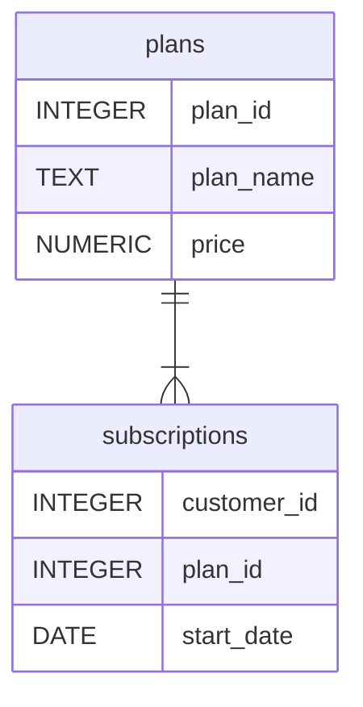

<div align = center>

# Foodie Fi
</div>

## Table of Contents
- [Problem Statement](#problem-statement)
- [Dataset](#dataset)
- [Case Study](#case-study)

## Problem Statement

While subscription-based businesses continue to grow, Danny identified a market gap for a streaming platform dedicated to food-related content. He launched Foodie-Fi in 2020, offering monthly and annual subscriptions to exclusive cooking videos. Using subscription data, Foodie-Fi aims to gain insights into customer behaviour and subscription trends to support data-driven investment decisions and feature improvements.

## Dataset
Danny has shared the data design for Foodie-Fi featuring two tables: plans and subscriptions. The relationship is illustrated in the following diagram:




### Plans
Customers can choose their plans when they sign up. Basic plan provides limited stream only access for $9.90 monthly. Pro plan offers unlimited watch time and downloads for offline viewing which start at $19.90 per month or $199 for annual subscription. Customers can avail a 7-day free trial whic automatically continues with the pro monthly subscription plan unless they cancel, downgrade to basic, or upgrade to an annual pro plan at any point during the trial.

When customers cancel their service, they will have a churn plan record with a null price but their plan continues until the billing period ends.

<div align = center>

| plan_id |	plan_name | price |
| ---- | --- | ---- |
0 |	trial |	0
1 |	basic monthly |	9.90
2 |	pro monthly	| 19.90
3 |	pro annual |	199
4 |	churn |	null
</div>

### Subscriptions
The subscription table shows the exact date where each customer's plan_id starts.

If customers downgrade from a pro plan or cancel their subscription - the higher plan will remain in place until the period is over - the start_date in the subscriptions table will reflect the date that the actual plan changes.

When customers upgrade their account from a basic plan to a pro or annual pro plan - the higher plan will take effect straightaway.

When customers churn - they will keep their access until the end of their current billing period but the start_date will be technically the day they decided to cancel their service.

<div align = center>

| customer_id | plan_name     | start_date |
|-------------|---------------|------------|
| 1           | trial         | 2020-08-01 |
| 1           | basic monthly | 2020-08-08 |
| 2           | trial         | 2020-09-20 |
| 2           | pro annual    | 2020-09-27 |
| 11          | trial         | 2020-11-19 |
| 11          | churn         | 2020-11-26 |
| 13          | trial         | 2020-12-15 |
| 13          | basic monthly | 2020-12-22 |
| 13          | pro monthly   | 2021-03-29 |
| 15          | trial         | 2020-03-17 |
| 15          | pro monthly   | 2020-03-24 |
| 15          | churn         | 2020-04-29 |
| 16          | trial         | 2020-05-31 |
| 16          | basic monthly | 2020-06-07 |
| 16          | pro annual    | 2020-10-21 |
| 18          | trial         | 2020-07-06 |
| 18          | pro monthly   | 2020-07-13 |
| 19          | trial         | 2020-06-22 |
| 19          | pro monthly   | 2020-06-29 |
| 19          | pro annual    | 2020-08-29 |

</div>

## Case Study

### Customer Journey
Based off the 8 sample customers provided in the sample from the subscriptions table, write a brief description about each customer’s onboarding journey.

```
SELECT
    s.customer_id,
    p.plan_name,
    s.start_date
INTO #customer_sample
FROM subscriptions AS s
JOIN plans AS p
ON s.plan_id = p.plan_id
WHERE s.customer_id IN (1,2,11,13,15,16,18,19)

SELECT *
FROM #customer_sample   
ORDER BY customer_id, start_date
```
*This query joins the subscriptions table to the plans table to access plan names. The result is filtered using WHERE statement to show only the subscription details of customers 1,2,11,13,15,16,18,19.*


| customer_id | plan_name     | start_date |
|-------------|---------------|------------|
| 1           | trial         | 2020-08-01 |
| 1           | basic monthly | 2020-08-08 |
| 2           | trial         | 2020-09-20 |
| 2           | pro annual    | 2020-09-27 |
| 11          | trial         | 2020-11-19 |
| 11          | churn         | 2020-11-26 |
| 13          | trial         | 2020-12-15 |
| 13          | basic monthly | 2020-12-22 |
| 13          | pro monthly   | 2021-03-29 |
| 15          | trial         | 2020-03-17 |
| 15          | pro monthly   | 2020-03-24 |
| 15          | churn         | 2020-04-29 |
| 16          | trial         | 2020-05-31 |
| 16          | basic monthly | 2020-06-07 |
| 16          | pro annual    | 2020-10-21 |
| 18          | trial         | 2020-07-06 |
| 18          | pro monthly   | 2020-07-13 |
| 19          | trial         | 2020-06-22 |
| 19          | pro monthly   | 2020-06-29 |
| 19          | pro annual    | 2020-08-29 |


- **Customer 1** initially subscribed to the 7-day trial and upgraded to Basic Monthly after the trial.

- **Customer 2** initially subscribed to the 7-day trial and upgraded to a Pro Annual plan after.

- **Customer 11** initially subscribed to the 7-day trial but churned after the trial period.

- **Customer 13** initially subscribed to the 7-day trial, upgraded to a Basic Monthly plan, and upgraded again to Pro Monthly after 3 months.

- **Customer 15** initially subscribed to the 7-day trial, upgraded to a Pro Monthly plan for 1 month, then churned.

- **Customer 16** initially subscribed to the 7-day trial, upgraded to Basic Monthly, then upgraded again to a Pro Annual plan after 4 months.

- **Customer 18** initially subscribed to the 7-day trial and upgraded to Pro Monthly after.

- **Customer 19** initially subscribed to the 7-day trial, upgraded to a Pro Monthly plan, then upgraded again to a Pro Annual Month after 2 months.


### Data Analysis Questions

#### 1. How many customers has Foodie-Fi ever had?
```
SELECT
    COUNT(DISTINCT customer_id) AS total_customer_count
FROM subscriptions
```
*Used COUNT(DISTINCT) to count unique customers.*

| total_customer_count |
| --- |
| 1000 |

#### 2. What is the monthly distribution of trial plan start_date values for our dataset - use the start of the month as the group by value.
```
SELECT
    DATENAME(month, DATETRUNC(month, start_date)) AS trial_start_month,
    COUNT(*) AS count
FROM subscriptions
WHERE
    plan_id = 0
GROUP BY DATETRUNC(month, start_date)
ORDER BY DATETRUNC(month, start_date) ASC
```
*Used DATETRUNC to round down the start dates to the start of the month for grouping and sorting the result. Used DATENAME to display the month names for readability. Filtered with plan_id = 0 to show only trial period entries.*


| trial_start_month | count |
|-------------------|-------|
| January           | 88    |
| February          | 68    |
| March             | 94    |
| April             | 81    |
| May               | 88    |
| June              | 79    |
| July              | 89    |
| August            | 88    |
| September         | 87    |
| October           | 79    |
| November          | 75    |
| December          | 84    |

#### 3. What plan start_date values occur after the year 2020 for our dataset? Show the breakdown by count of events for each plan_name.
```
SELECT
    plan_name,
    COUNT(*) AS num_events
FROM subscriptions AS s
JOIN plans as p
ON s.plan_id = p.plan_id
WHERE YEAR(start_date) > 2020
GROUP BY s.plan_id, plan_name
ORDER BY s.plan_id
```

*Joined subscriptions and plans table to match the plan ids to plan names for clarity. Filtered using WHERE() to show events after 2020. Grouped by the plan_id and plan_name and counted the subscriptions per plan. The final result is ordered by plan_id.*

| plan_name     | num_events |
| :------------ | :--------- |
| basic monthly | 8          |
| pro monthly   | 60         |
| pro annual    | 63         |
| churn         | 71         |

#### 4. What is the customer count and percentage of customers who have churned rounded to 1 decimal place?

```
SELECT 
    COUNT(DISTINCT customer_id) AS customer_count,
    CAST(
        ROUND(COUNT(DISTINCT customer_id)*100.0/
            (SELECT COUNT(DISTINCT customer_id) FROM subscriptions),1) 
        AS DECIMAL(10,1)) AS churn_pct
FROM subscriptions
WHERE plan_id = 4
```
*Limited the results to churned customers using WHERE plan_id = 4. Used COUNT(DISTINCT customer_id) to count unique churned customers and calculate the churn percentage against the total customer count. Applied ROUND() and CAST() for format clarity.*

| customer_count | churn_pct |
| ---- | ---- |
| 307 | 30.7 |

#### 5. How many customers have churned straight after the free trial - what percentage is this rounded to whole number?
```
WITH customer_plans_cte AS(
    SELECT
        ROW_NUMBER() OVER(
            PARTITION BY customer_id
            ORDER BY start_date ASC
        ) AS step_num,
        *
        FROM subscriptions
)
SELECT
    COUNT(*) AS churned_after_trial,
    CAST(COUNT(*) *100.0 / 
        (SELECT COUNT(DISTINCT customer_id) FROM subscriptions) 
        AS INT) AS churned_pct

FROM customer_plans_cte 
WHERE plan_id = 4 AND step_num = 2
```
*Used a common table expression (CTE) to assign sequential numbers to each subscription event (step_num) per customer. Limited results to churn events (plan_id = 4) occuring right after trial (step_num = 2). Calculated the percentage by dividing over total count and multiplying to 100.*

| customer_count | churn_pct |
| ---- | ---- |
| 92 | 9 |

#### 6. What is the number and percentage of customer plans after their initial free trial?

```
WITH customer_plans_cte AS(
    SELECT
        ROW_NUMBER() OVER(
            PARTITION BY customer_id
            ORDER BY start_date ASC
        ) AS step_num,
        *
        FROM subscriptions
)
SELECT
    p.plan_name,
    COUNT(*) AS count_after_trial,
    CAST(COUNT(*) *100.0 / (SELECT COUNT(DISTINCT customer_id) FROM subscriptions) AS INT) AS pct
FROM customer_plans_cte AS c
JOIN plans AS p
ON p.plan_id = c.plan_id
WHERE step_num =2
GROUP BY c.plan_id, plan_name
ORDER BY c.plan_id
```
*Using the same customer_plans_cte CTE joined with plans to match the plan names. Limited the results to the subscription events occurring after the trial (step_num = 2). Grouped by plan_id and plan_name to count records for each plan and calculate percentages. Final results are ordered by plan_id.*

| plan_name     | count_after_trial | pct |
| :------------ | :---------------- | :-- |
| basic monthly | 546               | 54  |
| pro monthly   | 325               | 32  |
| pro annual    | 37                | 3   |
| churn         | 92                | 9   |

#### 7. What is the customer count and percentage breakdown of all 5 plan_name values at 2020-12-31?

```
WITH ranked_plans AS (
SELECT
    customer_id,
    plan_id,
   ROW_NUMBER() OVER(
            PARTITION BY customer_id
            ORDER BY start_date DESC
        ) AS plan_latest_n
FROM subscriptions
WHERE start_date <= '2020-12-31'

)
SELECT
    p.plan_name,
    COUNT(rp.customer_id) AS latest_count,
    CAST(COUNT(*) *100.0 / 
        (SELECT COUNT(DISTINCT customer_id) FROM subscriptions) 
        AS DECIMAL(10,2)) AS pct
FROM ranked_plans AS rp
JOIN plans AS p
ON rp.plan_id = p.plan_id
WHERE plan_latest_n = 1
GROUP BY rp.plan_id, p.plan_name
ORDER BY rp.plan_id
```
*A CTE (ranked_plans) was used to assign ranks to subscription events for each customer according to its start_date, from latest to oldest, until Dec. 31, 2020. This table is joined with plans to get the plan names, filtered to get latest plans for each customer (plan_latest_n = 1) and grouped by plan to get the count and percentage.*

| plan_name     | count_after_trial | pct |
| :------------ | :---------------- | :-- |
| trial         | 19                | 1.90   |
| basic monthly | 224               | 22.40  |
| pro monthly   | 326               | 32.60  |
| pro annual    | 195               | 19.50  |
| churn         | 236               | 23.60  |

#### 8. How many customers have upgraded to an annual plan in 2020?

```
WITH next_plan_cte AS (
SELECT
    customer_id,
    plan_id,
    start_date,
    LEAD(plan_id) OVER (
        PARTITION BY customer_id
        ORDER BY start_date ASC
    ) AS next_plan_id,
        LEAD(start_date) OVER (
            PARTITION BY customer_id
            ORDER BY start_date ASC
        ) AS upgrade_date
FROM subscriptions
) SELECT
    COUNT(DISTINCT customer_id) AS upgraded_customers
FROM next_plan_cte
WHERE next_plan_id = 3 AND YEAR(upgrade_date) = 2020
```
| upgraded_customers |
| --- |
| 195 |

#### 9. How many days on average does it take for a customer to upgrade to an annual plan from the day they join Foodie-Fi?

```
SELECT
    ROUND(AVG(
        DATEDIFF(day, t.start_date, a.start_date)*1.0),
        2) AS avg_day_to_annual
FROM subscriptions AS t
JOIN subscriptions AS a
ON t.customer_id = a.customer_id
WHERE t.plan_id = 0 AND a.plan_id =3
```

| avg_day_to_annual |
| --- |
| 104.62 |

#### 10. Further breakdown this average value into 30 day periods (i.e. 0-30 days, 31-60 days etc)

```
SELECT
    CONCAT(
		FLOOR(DATEDIFF(day, t.start_date, a.start_date) / 30) * 30, 
			'-', FLOOR(DATEDIFF(day, t.start_date, a.start_date) / 30) 
            * 30 + 30) AS period_of_days,
	COUNT(DISTINCT t.customer_id) customer_count,
    ROUND(AVG(DATEDIFF(day, t.start_date, a.start_date)*1.0),2) AS avg_days_to_annual
FROM subscriptions AS t
JOIN subscriptions AS a
ON t.customer_id = a.customer_id
WHERE t.plan_id = 0 AND a.plan_id =3 
GROUP BY FLOOR(DATEDIFF(day, t.start_date, a.start_date) / 30)
```

| period_of_days | customer_count | avg_days_to_annual |
| :----------- | :------------- | :----------------- |
| 0-30          | 48             | 9.540000           |
| 30-60        | 25             | 41.840000          |
| 60-90        | 33             | 70.880000          |
| 90-120       | 35             | 99.830000          |
| 120-150      | 43             | 133.050000         |
| 150-180      | 35             | 161.540000         |
| 180-210      | 27             | 190.330000         |
| 210-240      | 4              | 224.250000         |
| 240-270      | 5              | 257.200000         |
| 270-300      | 1              | 285.000000         |
| 300-330      | 1              | 327.000000         |
| 330-360      | 1              | 346.000000         |

#### 11. How many customers downgraded from a pro monthly to a basic monthly plan in 2020?

```
WITH customer_plans_cte AS (
    SELECT
        customer_id,
        plan_id,
        start_date,
        LAG(plan_id) OVER (
            PARTITION BY customer_id
            ORDER BY start_date ASC
        ) AS previous_plan_id
    FROM subscriptions
)
SELECT
    COUNT(DISTINCT customer_id) AS downgraded_plans
FROM customer_plans_cte
WHERE plan_id < previous_plan_id
AND YEAR(start_date) = 2020
```

| downgraded_plans |
| --- |
| 0 |

### Challenge: Payments Table

The Foodie-Fi team wants you to create a new payments table for the year 2020 that includes amounts paid by each customer in the subscriptions table with the following requirements:

- monthly payments always occur on the same day of month as the original start_date of any monthly paid plan
- upgrades from basic to monthly or pro plans are reduced by the current paid amount in that month and start immediately
- upgrades from pro monthly to pro annual are paid at the end of the current billing period and also starts at the end of the month period
- once a customer churns they will no longer make payments

### Outside the Box Questions

#### 1. How would you calculate the rate of growth for Foodie-Fi?

#### 2. What key metrics would you recommend Foodie-Fi management to track over time to assess performance of their overall business?


What are some key customer journeys or experiences that you would analyse further to improve customer retention?
If the Foodie-Fi team were to create an exit survey shown to customers who wish to cancel their subscription, what questions would you include in the survey?
What business levers could the Foodie-Fi team use to reduce the customer churn rate? How would you validate the effectiveness of your ideas?