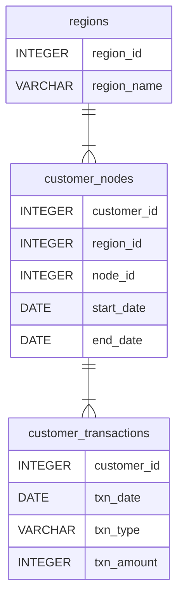

<div align = center>

# Data Bank

</div>

## Table of Contents
- [Problem Statement](#problem-statement)
- [Dataset](#dataset)

## Problem Statement

Danny launched a new digital banking initiative, the Data Bank, which combines traditional banking services with cloud data storage. Unlike other digital banks, Data Bank allocates cloud storage limits based on how much a customer has in their account. 

The management team at Data Bank needs to analyze customer banking and transaction data to understand customer growth, account balances, and cloud storage requirements. This case study aims to calculate key business metrics, identify growth trends, and estimate the amount of data storage required by customers.

## Dataset 

The Data Bank team has prepared the data model for this case study as well as a few example rows for the complete dataset.

The database has three tables, `regions`, `customer_nodes`, and `customer_transactions`. Their relationship is illustrated in the following ER diagram:



### Regions Table
This table contains the `region_id` and their respective `region_name` values.

<div align = center>

| region_id | region_name |
| :---: | --- |
| 1 | Africa |
| 2 | America |
| 3 | Asia |
| 4 | Europe |
| 5 | Oceania |

</div>

### Customer Nodes Table

Customers are randomly distributed across the nodes according to their region, specifying exactly which node contains both their cash and data. This table tracks the movement of customers across different nodes within their respective regions.

<div align = center>

| customer_id | region_id | node_id | start_date | end_date   |
| :---------: | :-------: | :-----: | :--------- | :--------- |
| 1           | 3         | 4       | 2020-01-02 | 2020-01-03 |
| 2           | 3         | 5       | 2020-01-03 | 2020-01-17 |
| 3           | 5         | 4       | 2020-01-27 | 2020-02-18 |
| 4           | 5         | 4       | 2020-01-07 | 2020-01-19 |
| 5           | 3         | 3       | 2020-01-15 | 2020-01-23 |
| 6           | 1         | 1       | 2020-01-11 | 2020-02-06 |
| 7           | 2         | 5       | 2020-01-20 | 2020-02-04 |
| 8           | 1         | 2       | 2020-01-15 | 2020-01-28 |
| 9           | 4         | 5       | 2020-01-21 | 2020-01-25 |
| 10          | 3         | 4       | 2020-01-13 | 2020-01-14 |

</div>

### Customer Transactions Table

This table stores transaction details for customer deposits, withdrawals, and purchases made using the debit card.

<div align = center>

| customer_id | txn_date   | txn_type | txn_amount |
| :---------: | :--------- | :------- | :--------- |
| 429         | 2020-01-21 | deposit  | 82         |
| 155         | 2020-01-10 | deposit  | 712        |
| 398         | 2020-01-01 | deposit  | 196        |
| 255         | 2020-01-14 | deposit  | 563        |
| 185         | 2020-01-29 | deposit  | 626        |
| 309         | 2020-01-13 | deposit  | 995        |
| 312         | 2020-01-20 | deposit  | 485        |
| 376         | 2020-01-03 | deposit  | 706        |
| 188         | 2020-01-13 | deposit  | 601        |
| 138         | 2020-01-11 | deposit  | 520        |
</div>

## Case Study

### Customer Nodes Exploration

#### 1. How many unique nodes are there on the Data Bank system?
```
SELECT
	COUNT(DISTINCT node_id) AS node_count
FROM customer_nodes
```
> Used COUNT(DISTINCT) to find the number of unique nodes from customer_nodes table

| node_count |
| --- |
| 5 |

#### 2. What is the number of nodes per region?
```
SELECT
	region_name,
	COUNT(DISTINCT node_id) AS node_count
FROM customer_nodes AS cn
JOIN regions AS r
	ON cn.region_id = r.region_id
GROUP BY region_name
```

| region_name | node_count |
| :---------- | :--------- |
| Africa      | 5          |
| America     | 5          |
| Asia        | 5          |
| Australia   | 5          |
| Europe      | 5          |

#### 3. How many customers are allocated to each region?
```
SELECT
	region_name,
	COUNT(DISTINCT customer_id) AS customer_count
FROM customer_nodes AS cn
JOIN regions AS r
	ON cn.region_id = r.region_id
GROUP BY region_name
```

| region_name | node_count |
| :---------- | :--------- |
| Africa      | 102        |
| America     | 105        |
| Asia        | 95         |
| Australia   | 110        |
| Europe      | 88         |


#### 4. How many days on average are customers reallocated to a different node?
```
SELECT DISTINCT end_date
FROM customer_nodes
ORDER BY end_date DESC
-- problematic date found '9999-12-31'; exclude from calculation

SELECT 
	AVG(DATEDIFF(DAY, start_date, end_date)) AS avg_number_of_day
FROM customer_nodes
WHERE end_date != '9999-12-31'
```


#### 5. What is the median, 80th and 95th percentile for this same reallocation days metric for each region?
```
WITH reallocation_days_cte AS (
SELECT 
	customer_id,
	cn.region_id,
	region_name,
	DATEDIFF(DAY, start_date, end_date) AS reallocation_days
FROM customer_nodes AS cn
JOIN regions r
	ON cn.region_id = r.region_id
WHERE end_date != '9999-12-31'
)
SELECT DISTINCT
	region_name,
	PERCENTILE_CONT(0.5) WITHIN GROUP(ORDER BY reallocation_days) OVER(PARTITION BY region_name) AS median,
	PERCENTILE_CONT(0.8) WITHIN GROUP(ORDER BY reallocation_days) OVER(PARTITION BY region_name) AS percentile_80,
	PERCENTILE_CONT(0.95) WITHIN GROUP(ORDER BY reallocation_days) OVER(PARTITION BY region_name) AS percentile_95
FROM reallocation_days_cte
```
| region_name | median | percentile_80 | percentile_95 |
| :---------- | :----- | :------------ | :------------ |
| Australia   | 15     | 23            | 28            |
| Africa      | 15     | 24            | 28            |
| Asia        | 15     | 23            | 28            |
| America     | 15     | 23            | 28            |
| Europe      | 15     | 24            | 28            |

---

### Customer Transactions

#### 1. What is the unique count and total amount for each transaction type?
```
SELECT
	txn_type,
	COUNT(txn_id) AS unique_cnt,
	SUM(txn_amount) AS total_amt
FROM 
customer_transactions
GROUP BY txn_type
```

| txn_type   | unique_cnt | total_amt |
| :--------- | :--------- | :-------- |
| withdrawal | 1580       | 793003    |
| deposit    | 2671       | 1359168   |
| purchase   | 1617       | 806537    |

#### 2. What is the average total historical deposit counts and amounts for all customers?
```

```

#### 3. For each month - how many Data Bank customers make more than 1 deposit and either 1 purchase or 1 withdrawal in a single month?
#### 4. What is the closing balance for each customer at the end of the month?
#### 5. What is the percentage of customers who increase their closing balance by more than 5%?