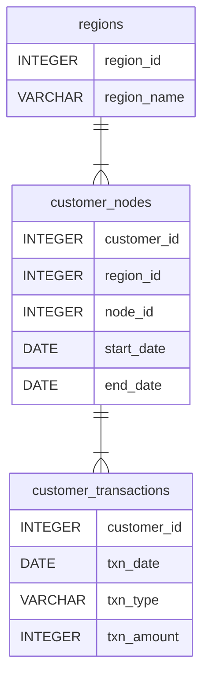

# Data Bank

## Table of Contents
- [Table of Contents](#table-of-contents)
- [Problem Statement](#problem-statement)
- [Dataset](#dataset)

## Problem Statement

## Dataset 

### Regions Table
This table contains the `region_id` and their respective `region_name` values

| region_id | region_name |
| :---: | --- |
| 1 | Africa |
| 2 | America |
| 3 | Asia |
| 4 | Europe |
| 5 | Oceania |

### Customer Nodes Table

| customer_id | region_id | node_id | start_date | end_date   |
| :---------: | :-------: | :-----: | :--------- | :--------- |
| 1           | 3         | 4       | 2020-01-02 | 2020-01-03 |
| 2           | 3         | 5       | 2020-01-03 | 2020-01-17 |
| 3           | 5         | 4       | 2020-01-27 | 2020-02-18 |
| 4           | 5         | 4       | 2020-01-07 | 2020-01-19 |
| 5           | 3         | 3       | 2020-01-15 | 2020-01-23 |
| 6           | 1         | 1       | 2020-01-11 | 2020-02-06 |
| 7           | 2         | 5       | 2020-01-20 | 2020-02-04 |
| 8           | 1         | 2       | 2020-01-15 | 2020-01-28 |
| 9           | 4         | 5       | 2020-01-21 | 2020-01-25 |
| 10          | 3         | 4       | 2020-01-13 | 2020-01-14 |

### Customer Transactions Table

| customer_id | txn_date   | txn_type | txn_amount |
| :---------: | :--------- | :------- | :--------- |
| 429         | 2020-01-21 | deposit  | 82         |
| 155         | 2020-01-10 | deposit  | 712        |
| 398         | 2020-01-01 | deposit  | 196        |
| 255         | 2020-01-14 | deposit  | 563        |
| 185         | 2020-01-29 | deposit  | 626        |
| 309         | 2020-01-13 | deposit  | 995        |
| 312         | 2020-01-20 | deposit  | 485        |
| 376         | 2020-01-03 | deposit  | 706        |
| 188         | 2020-01-13 | deposit  | 601        |
| 138         | 2020-01-11 | deposit  | 520        |

## Case Study

### Customer Nodes Exploration

#### 1. How many unique nodes are there on the Data Bank system?
#### 2. What is the number of nodes per region?
#### 3. How many customers are allocated to each region?
#### 4. How many days on average are customers reallocated to a different node?
#### 5. What is the median, 80th and 95th percentile for this same reallocation days metric for each region?

### Customer Transactions

#### 1. What is the unique count and total amount for each transaction type?
#### 2. What is the average total historical deposit counts and amounts for all customers?
#### 3. For each month - how many Data Bank customers make more than 1 deposit and either 1 purchase or 1 withdrawal in a single month?
#### 4. What is the closing balance for each customer at the end of the month?
#### 5. What is the percentage of customers who increase their closing balance by more than 5%?